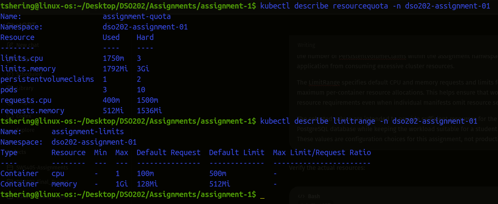
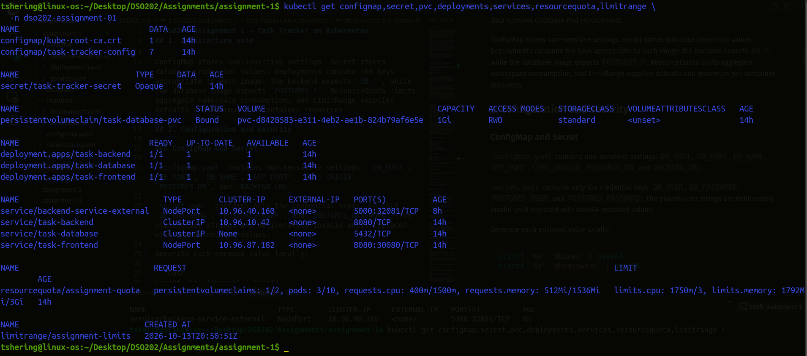
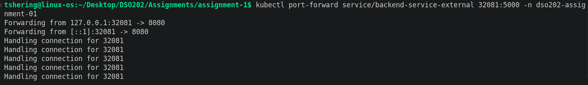
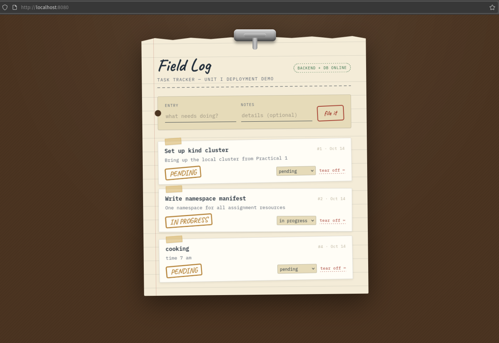
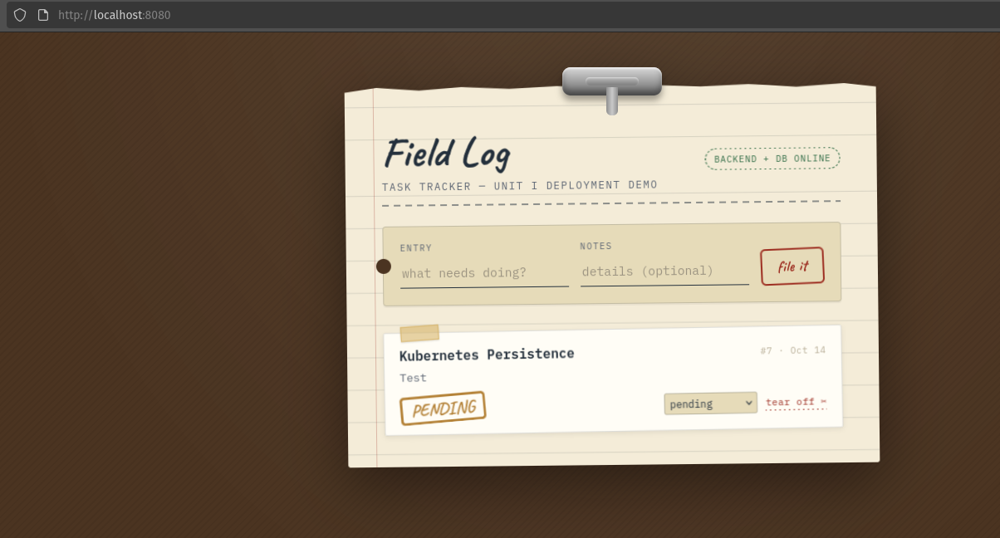
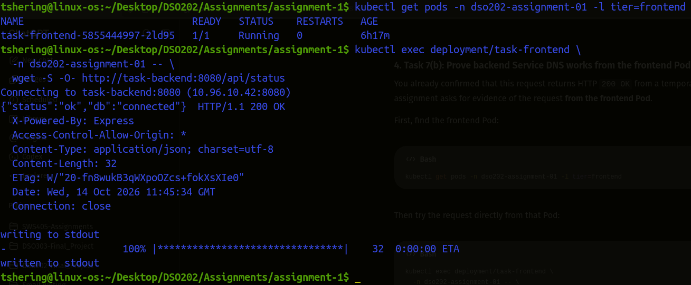
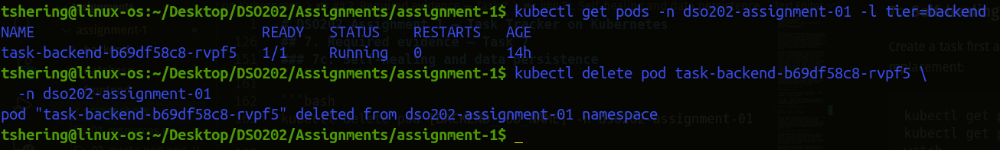
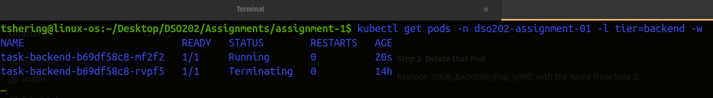
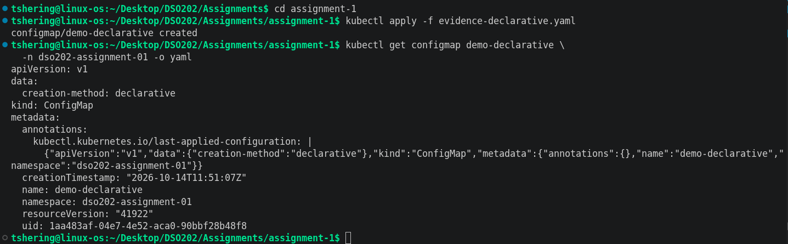
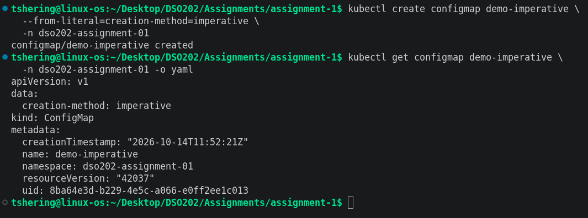

# DSO202 Assignment 1 — Task Tracker on Kubernetes

**Student:** Tshering Phuntsho  
**Student ID:** 02230310  
**Module:** DSO202 — Scaling, Orchestration, Monitoring & Observability    
**Cluster:** dso202-assignment-01  
**Date:** 7 September, 2026  

## 1. Architecture note

Kubernetes uses the control plane to manage the desired state of this application. The API server receives the manifests and stores the desired objects in etcd. The scheduler assigns each Pod to a suitable worker node. The controller manager runs controllers such as the Deployment/ReplicaSet controllers, which maintain the requested replicas. On the worker node, the kubelet asks the container runtime to run the containers, while the cluster network and CoreDNS provide Pod networking and Service-name resolution. The exact control-plane arrangement depends on how the local `kind` cluster was created.

The application has three tiers in the `dso202-assignment-01` namespace. The frontend Deployment runs `pulu18/taskfrontend:1.0.0` and is exposed using NodePort `30080` for browser access. Because this frontend makes API requests directly from the browser, `configmap.yaml` sets `BACKEND_URL` to `http://localhost:32081`. The backend Deployment runs `pulu18/taskbackend:1.0.0`; `backend/service.yaml` keeps the internal ClusterIP Service for cluster DNS checks, while `backend/backend-external-service.yaml` exposes the same backend through NodePort `32081`. The backend connects to the database using `DB_HOST=task-database` and port 5432. The database Deployment runs `pulu18/taskdb:1.0.0` and is accessed through a headless Service. A PersistentVolumeClaim requests storage for PostgreSQL data so that data survives database Pod replacement.

ConfigMap stores non-sensitive settings. Secret stores database credential values. Deployments consume the keys appropriate to each image: the backend expects `DB_*`, while the database image expects `POSTGRES_*`. ResourceQuota limits aggregate namespace consumption, and LimitRange supplies defaults and maximum per-container resources.

## 2. Configuration and security

### ConfigMap and Secret

`configmap.yaml` contains non-sensitive settings: `DB_HOST`, `DB_PORT`, `DB_NAME`, `APP_PORT`, `CORS_ORIGIN`, `POSTGRES_DB`, and `BACKEND_URL`.

`secret.yaml` contains only the credential keys: `DB_USER`, `DB_PASSWORD`, `POSTGRES_USER`, and `POSTGRES_PASSWORD`. 

Generate each encoded value locally:

```bash
printf '%s' 'dbuser' | base64
printf '%s' 'dbpassword' | base64
```

Copy the outputs into the matching keys in `secret.yaml`. Use the same database username and password for `DB_USER`/`POSTGRES_USER` and `DB_PASSWORD`/`POSTGRES_PASSWORD`, respectively. Do not put actual plaintext credentials in Git. Base64 is encoding, not encryption. Kubernetes Secrets are **base64-encoded and are not encrypted at rest by default**; access controls and cluster encryption configuration are separate concerns.

### ResourceQuota and LimitRange justification


**Figure-1:** ResourceQuota and limitRange

The ResourceQuota sets a namespace ceiling of 1.5 CPU cores and 1536 MiB of requested memory, with maximum aggregate limits of 3 CPU cores and 3 GiB memory. It also caps the namespace at 10 Pods and 2 PVCs. These are modest local-development limits intended to prevent this assignment from consuming the whole workstation while leaving room for the three single-replica tiers.

The LimitRange supplies a default request of 100m CPU and 128Mi memory and a default limit of 500m CPU and 512Mi memory when a container omits these values. It also caps an individual container at 1 CPU and 1Gi memory. The explicit requests and limits in the Deployments are tuned by tier: the backend receives more memory because it handles API work; the database receives persistent storage and moderate resources; the frontend has lighter defaults. Adjust these values if your instructor's cluster resources or application behavior require it, and explain any changes.

## 3. Repository structure

```text
assignment-1/
├── namespace.yaml
├── configmap.yaml
├── secret.yaml
├── quota.yaml
├── database/
│   ├── pvc.yaml
│   ├── deployment.yaml
│   └── service.yaml
├── backend/
│   ├── deployment.yaml
│   ├── service.yaml
│   └── backend-external-service.yaml
├── frontend/
│   ├── deployment.yaml
│   └── service.yaml
├── screenshots
│   ├── ...
│   └── ...
└── README.md
```

## 4. Before deployment

1. Confirm your `kind` cluster is running: `kind get clusters` and `kubectl cluster-info`.
2. Confirm the expected NodePort mappings exist in your kind configuration. This template uses frontend NodePort `30080` and backend NodePort `32081`. If the cluster was not created with matching `extraPortMappings` entries, use the port-forward alternative below or recreate the cluster with the required mappings.
3. Confirm the database image is compatible with PostgreSQL's standard environment variables and data path `/var/lib/postgresql/data`. If the provided image documentation specifies another data path or required variables, update the manifest accordingly.
4. Replace all Secret placeholders with base64 values. Ensure the backend and database credential values match.
5. Validate the YAML before applying.

## 5. Deploy

Run these commands from the directory containing `namespace.yaml`:

```bash
kubectl apply -f namespace.yaml
kubectl apply -f configmap.yaml
kubectl apply -f secret.yaml
kubectl apply -f quota.yaml
kubectl apply -f database/
kubectl apply -f backend/
kubectl apply -f frontend/

kubectl get all -n dso202-assignment-01
kubectl get pvc -n dso202-assignment-01
kubectl get resourcequota,limitrange -n dso202-assignment-01
kubectl get events -n dso202-assignment-01 --sort-by=.lastTimestamp
```

Wait for the Deployments:

```bash
kubectl rollout status deployment/task-database -n dso202-assignment-01
kubectl rollout status deployment/task-backend -n dso202-assignment-01
kubectl rollout status deployment/task-frontend -n dso202-assignment-01
```

If a rollout fails, inspect `kubectl describe pod`, `kubectl logs`, PVC status, and namespace events before proceeding.

**Kubernetes configuration**

**Figure-2:** Resources

## 6. Access the frontend

If kind has host mappings for ports `30080` and `32081`, open:

```text
http://localhost:30080
```

The frontend calls the backend through `http://localhost:32081`. The external backend Service maps NodePort `32081` to the backend container's port `8080`; no Ingress is required.

Otherwise, use a port-forward:

```bash
kubectl port-forward service/task-frontend 8080:8080 -n dso202-assignment-01
```

In another terminal, forward the backend as well:

```bash
kubectl port-forward service/backend-service-external 32081:5000 -n dso202-assignment-01
```

**Figure-3:** Port Forwarding

Then open `http://localhost:8080`.


**Figure-4:** Frontend UI

## 7. Required evidence — Task 7

### 7a. Full CRUD cycle

Use the frontend to create a task, list it, update it, and delete it. Record the actual task ID and results.


**Figure-5:** Task Created

The guide documents these backend endpoints: `GET /api/tasks`, `GET /api/tasks/{id}`, `POST /api/tasks`, `PUT /api/tasks/{id}`, `DELETE /api/tasks/{id}`, and `GET /api/status`. 

Like this I have updated and deleted the created task.

### 7b. Service DNS resolution from the frontend Pod

```bash
kubectl get pods -n dso202-assignment-01 -l tier=frontend
kubectl exec -n dso202-assignment-01 deploy/task-frontend --   wget -S -O- http://task-backend:8080/api/status
```

If the frontend image does not contain `wget` or the command is unavailable, use an available client in the image or document an approved alternative. The frontend image also requires the explicit shell command and runtime settings shown in `frontend/deployment.yaml` because its published `nginx` user is not resolvable by the cluster runtime. Save the output as evidence.


**Figure-6:** command run from frontend Pod and successful backend response

### 7c. Self-healing and data persistence

Create a task first and record its ID. Then delete the backend Pod and observe the replacement:

```bash
kubectl get pods -n dso202-assignment-01 -l tier=backend
kubectl get pods -n dso202-assignment-01 -l tier=backend --watch
```

In a second terminal, delete the current backend Pod by its actual name:

```bash
kubectl delete pod [BACKEND_POD_NAME] -n dso202-assignment-01
```

After the replacement Pod is Ready, retrieve the task created before deletion using the frontend or backend API.


**Figure-7:** old backend Pod deleted


**Figure-8:** old backend Pod deleted and replacement created

The persistence test should demonstrate database storage surviving backend Pod replacement. The PVC itself is mounted by the database Pod; for the strongest evidence, also verify task data survives database Pod replacement without deleting the PVC.

### 7d. Declarative vs. Imperative Resource Creation

The namespace is created declaratively in this submission:

```bash
kubectl apply -f namespace.yaml
```

For the imperative comparison, use a separate temporary namespace name so you do not disrupt the assignment namespace:

```bash
kubectl create namespace dso202-imperative-demo
kubectl get namespace dso202-imperative-demo
kubectl delete namespace dso202-imperative-demo
```

**Declarative approach:** A YAML manifest describes the desired state of a Kubernetes resource. The resource is created or updated using `kubectl apply -f`. The manifest can be stored in version control, reviewed, reused, and applied repeatedly to reconcile the resource with the declared configuration.


**Figure-9:** declarative

**Imperative approach:** A command such as `kubectl create configmap` specifies the resource and its configuration directly in the terminal. This is convenient for quick, one-time operations, but the command itself does not provide the same persistent desired-state file as a declarative manifest.

**Figure-10:** imperative

**Conclusion:** The declarative approach is preferable for the main assignment because the YAML manifests document the application's configuration and make deployment repeatable. Imperative commands remain useful for temporary tasks, troubleshooting, and quick demonstrations.


## 8. Troubleshooting

- **ImagePullBackOff:** check the image spelling/tag and Docker Hub access; try `docker login` if rate-limited.
- **Backend CrashLoopBackOff:** inspect logs and confirm the backend uses `DB_*` keys from ConfigMap/Secret.
- **Database startup failure:** check `POSTGRES_*` values, Secret values, and the image's required data path.
- **Frontend cannot reach backend:** check `BACKEND_URL` is `http://localhost:32081`, verify `backend-service-external` has endpoints, and confirm kind maps host port `32081`. With an existing cluster that lacks the mapping, run `kubectl port-forward service/backend-service-external 32081:5000 -n dso202-assignment-01`.
- **Backend cannot reach database:** check `DB_HOST=task-database`, port 5432, Service endpoints, and matching credentials.
- **PVC Pending:** run `kubectl get storageclass` and `kubectl describe pvc task-database-pvc -n dso202-assignment-01`.
- **NodePort not reachable:** verify kind `extraPortMappings` contains both `30080` and `32081`; recreate the kind cluster after changing its configuration, or use port-forwarding.
- **Quota blocks creation:** inspect `kubectl describe resourcequota assignment-quota -n dso202-assignment-01`.


