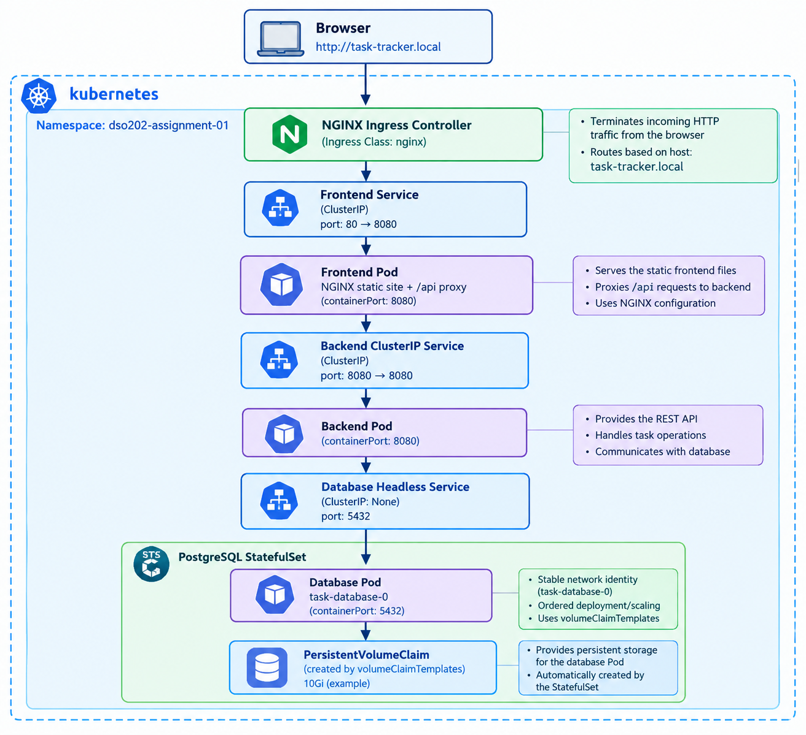
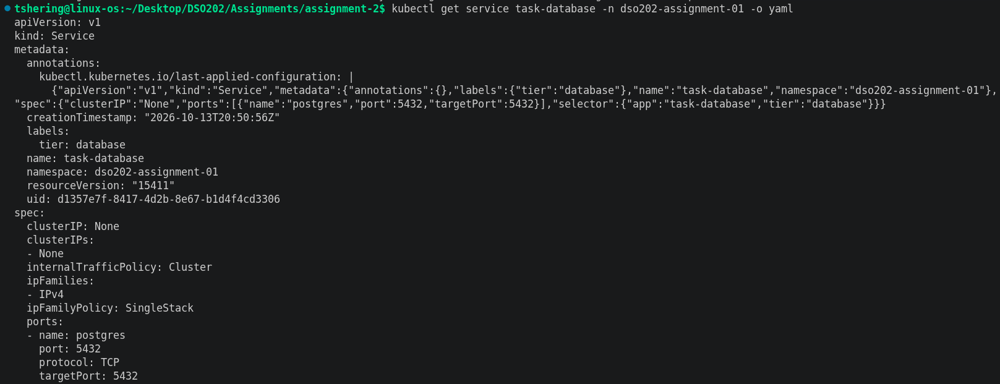
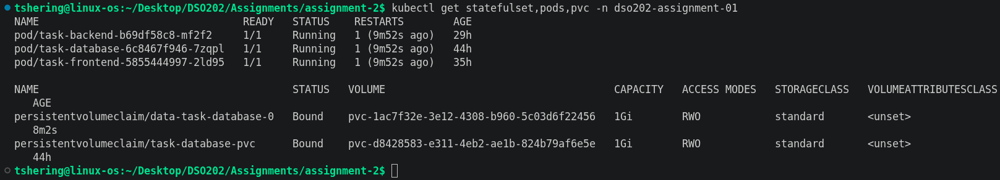
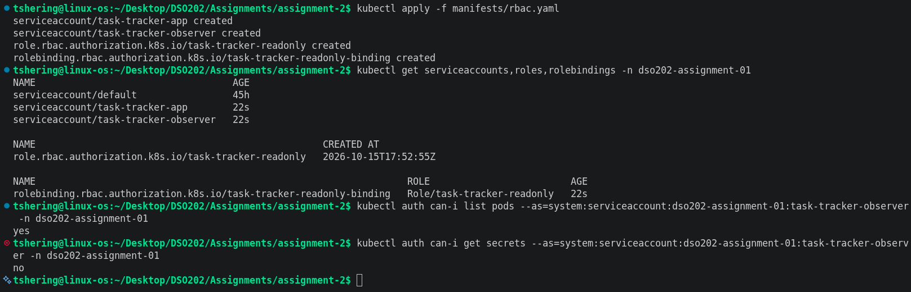
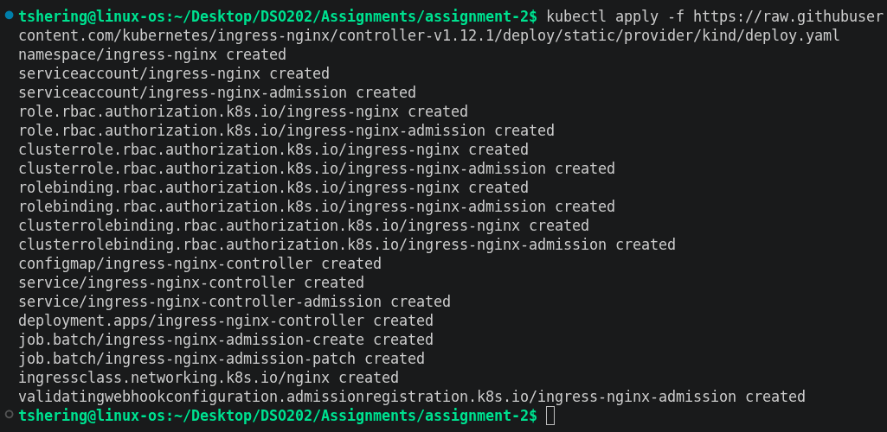
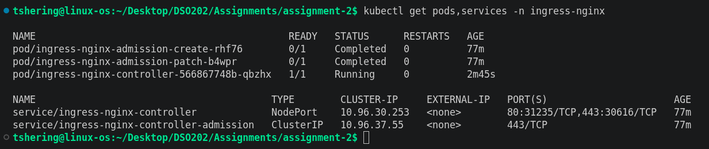
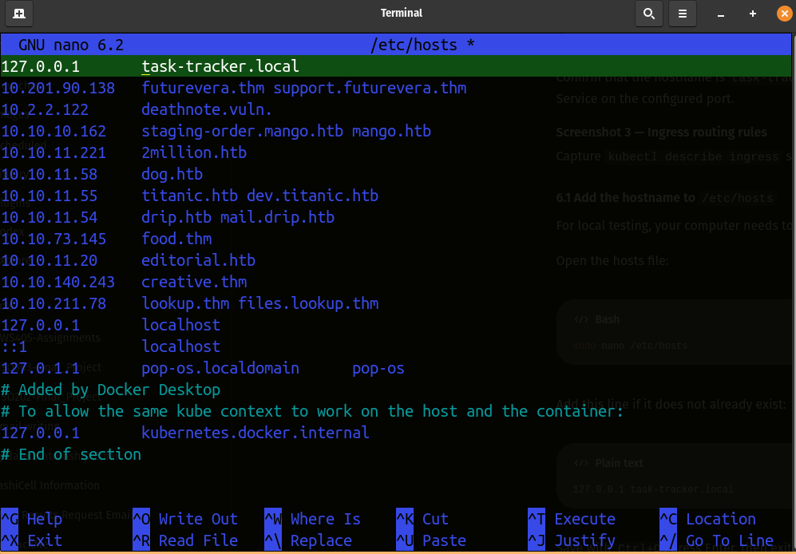
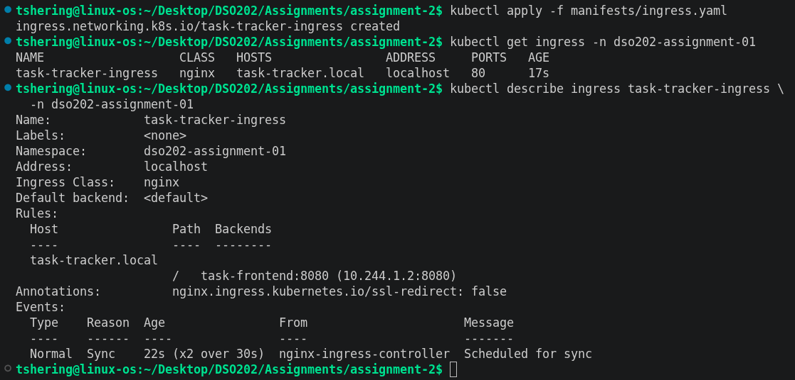
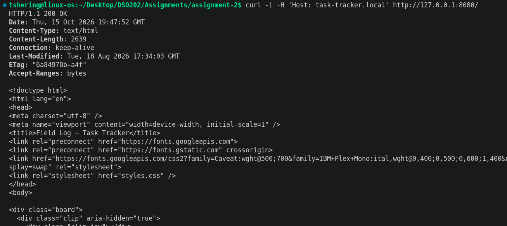
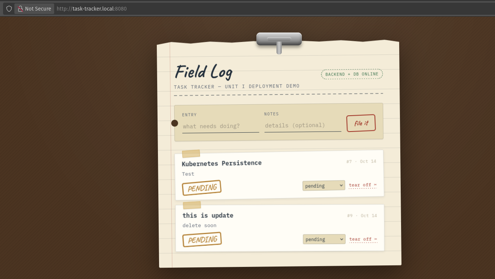

# DSO202 Assignment 2 - Applying Unit 2 Kubernetes Concepts to the Task Tracker Application

**Student:** Tshering Phuntsho  
**Student ID:** 02230310  
**Application:** Task Tracker (Assignment 1)  
**Namespace:** `dso202-assignment-01`  
**Cluster:** kind

## 1. Objective

The objective is to extend the Assignment 1 Task Tracker using Unit 2 concepts:

- **StatefulSets:** use cases, stable network identities, ordered deployment/scaling, headless Services and `volumeClaimTemplates`.
- **Ingress:** routing rules, TLS concepts, host-based routing, NGINX Ingress Controller and annotations.
- **RBAC:** Roles, RoleBindings and ServiceAccounts.

Application images remain `pulu18/taskfrontend:1.0.0`, `pulu18/taskbackend:1.0.0` and `pulu18/taskdb:1.0.0`.

## 2. Target architecture


The backend remains private behind a ClusterIP Service. Browser JavaScript should call relative paths such as `/api/tasks` and `/api/status`; frontend NGINX proxies `/api/` to `http://task-backend:8080` inside the cluster. A browser must not directly use the internal Kubernetes DNS name `task-backend`.

## 3. StatefulSets

### Rationale

PostgreSQL is stateful because it stores application data on disk. A StatefulSet provides a stable ordinal Pod name (for example, `task-database-0`) and ordered Pod management. `volumeClaimTemplates` allows Kubernetes to provision a dedicated PVC for each replica. This assignment uses one replica; a StatefulSet alone does not configure PostgreSQL replication or provide database high availability.

### Headless Service

The `task-database` Service should have `clusterIP: None` and be referenced by `spec.serviceName` in the StatefulSet. Check:

```bash
kubectl get service task-database -n dso202-assignment-01 -o yaml
kubectl get statefulset,pods,pvc -n dso202-assignment-01
```

After the migration, verify the Pod name is `task-database-0` and its generated PVC is `Bound`.





## 4. RBAC

RBAC stands for Role-Based Access Control. It controls which Kubernetes API operations a user or ServiceAccount can perform.

### ServiceAccounts and least privilege

`manifests/rbac.yaml` creates two ServiceAccounts:

- `task-tracker-app`: intended identity for application Pods, with automatic token mounting disabled because the application does not need Kubernetes API access.
- `task-tracker-observer`: a separate identity for demonstrating limited read-only access.

The observer identity is not bound to the application Pods.

### Role and RoleBinding

The namespaced Role allows `get`, `list` and `watch` on Pods, Services and Endpoints only in `dso202-assignment-01`. It does not grant access to Secrets, Deployments, or cluster-wide resources.

Apply and verify:

```bash
kubectl apply -f manifests/rbac.yaml
kubectl get serviceaccounts,roles,rolebindings -n dso202-assignment-01
kubectl auth can-i list pods --as=system:serviceaccount:dso202-assignment-01:task-tracker-observer -n dso202-assignment-01
kubectl auth can-i get secrets --as=system:serviceaccount:dso202-assignment-01:task-tracker-observer -n dso202-assignment-01
```


Listing Pods returns `yes`; getting Secrets returns `no`. These commands test authorization. They do not require giving Kubernetes API permissions to the application itself.

## 5. Ingress and Ingress Controller

An Ingress resource defines HTTP routing rules. The Ingress Controller is the software that implements those rules. I am going to use the NGINX Ingress Controller.

### Install NGINX Ingress Controller for kind

Commands:

```bash
kubectl apply -f https://raw.githubusercontent.com/kubernetes/ingress-nginx/controller-v1.12.1/deploy/static/provider/kind/deploy.yaml
kubectl wait --namespace ingress-nginx \
  --for=condition=Ready pod \
  --selector=app.kubernetes.io/component=controller \
  --timeout=180s
kubectl get pods,services -n ingress-nginx
```




### Host-based routing

For local testing, your computer needs to resolve task-tracker.local to your local machine.

The supplied `manifests/ingress.yaml` routes host `task-tracker.local` to the frontend Service. Add this entry to `/etc/hosts` on the Linux host:
```text
127.0.0.1 task-tracker.local
```

Edit with `sudo nano /etc/hosts`. With port-forwarding, open `http://task-tracker.local:8080`. If host port 80 is mapped to the controller, open `http://task-tracker.local` instead.


Apply and inspect the Ingress:

```bash
kubectl apply -f manifests/ingress.yaml
kubectl get ingress -n dso202-assignment-01
kubectl describe ingress task-tracker-ingress -n dso202-assignment-01
```


Use port 80 in the `curl` URL instead if the controller is exposed on host port 80.

```bash
curl -i -H 'Host: task-tracker.local' http://127.0.0.1:8080/
```


Task Tracker open at task-tracker.local



### Annotations and TLS

The Ingress manifest includes the NGINX-specific annotation `nginx.ingress.kubernetes.io/ssl-redirect: "false"` so local HTTP testing works. This is for a local coursework environment, not a production configuration. Production deployments should use TLS and redirect HTTP to HTTPS.

TLS termination requires a TLS Secret with a certificate and private key and a corresponding `spec.tls` entry in the Ingress. A self-signed certificate can be used for a local demonstration, but browsers will not consider it publicly trusted.

## 6. Challenges and observations
 
- **Ingress:** faced challenges in installing the NGINX ingress controller
- **Data migration:** [Describe backup/restore or the separate test environment used.]

## 7. Conclusion

This assignment applies Unit 2 concepts to the existing Task Tracker. A StatefulSet provides stable identity and claim-template-based persistent storage for PostgreSQL. An NGINX Ingress Controller and Ingress resource provide host-based HTTP routing to the frontend. RBAC demonstrates namespace-scoped permissions using ServiceAccounts, Roles and RoleBindings. The assignment is complete only after the resources are applied, actual behaviour is tested.
