# DSO202 Assignment 3: Task Tracker with Kustomize and Helm

**Student:** Tshering Phuntsho  
**Student ID:** 02230310  
**Module:** DSO202, Scaling, Orchestration, Monitoring & Observability  
**Unit:** IV, Kubernetes Configuration Management & Service Registry  
**Cluster:** dso202-assignment-01 (kind)  
**Date:** 27 OCtober, 2026

## 1. Introduction

Assignment 1 deployed a three-tier Task Tracker (frontend, backend API, PostgreSQL) on a local kind cluster using plain manifests applied one file at a time. That approach repeats configuration, hard-codes the namespace into every file and has no release history. This assignment re-implements the same application with two Unit 4 tools, **Kustomize** and **Helm**, and compares them. It also inspects **etcd**, the store behind all cluster state, and discusses how the tools fit into a version-controlled workflow.

**Objectives**

- Build a Kustomize base from the Assignment 1 manifests with ConfigMap and Secret generators.
- Create dev and prod overlays using strategic merge and JSON patches.
- Package the application as a Helm chart and manage releases (install, upgrade, history, rollback).
- Examine etcd (health, keys, backup) and use it to store application settings.
- Compare the tools and recommend a workflow.

## 2. Environment

| Item | Value |
| --- | --- |
| Cluster | kind, `dso202-assignment-01` |
| Images | pulu18/taskfrontend, taskbackend, taskdb 1.0.0 |
| kubectl / Kubernetes | v1.34.1 |
| Kustomize | built into kubectl (*version*) |
| Helm | v3.22.1 |
| Namespaces | dso202-assignment-03-dev, dso202-assignment-03-prod, dso202-assignment-03-helm |

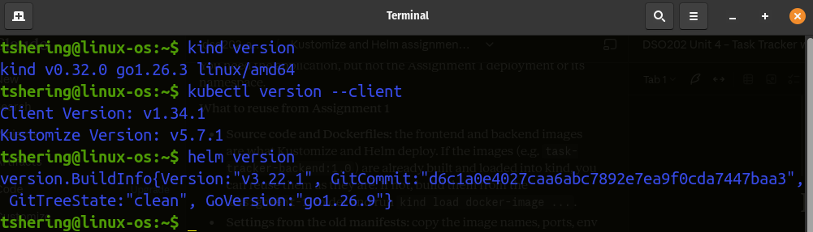
*Figure-1: Tool versions*

## 3. Architecture

The architecture is unchanged from Assignment 1: the browser reaches the frontend through NodePort 30080 and, because the frontend calls the API from the browser, the backend through NodePort 32081 (`backend-service-external`, port 5000 to container port 8080). The backend reaches PostgreSQL through the headless Service `task-database`, using values from the ConfigMap and Secret. The database stores data on `task-database-pvc`. A ResourceQuota and LimitRange bound the namespace.

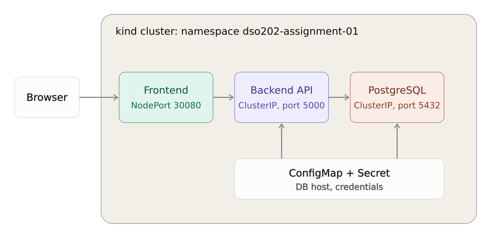
*Figure-2: Architecture diagram*

What changes is how the objects are produced:

| Assignment 1 | Assignment 3 |
| --- | --- |
| 12 YAML files applied with `kubectl apply -f`, namespace hard-coded | Kustomize base plus overlays, or one Helm chart |
| `configmap.yaml`, `secret.yaml` written by hand (base64) | Generated from `config.env` and `secret.env` (Kustomize) or from `values.yaml` (Helm) |
| One environment | dev, prod and Helm releases from the same source |

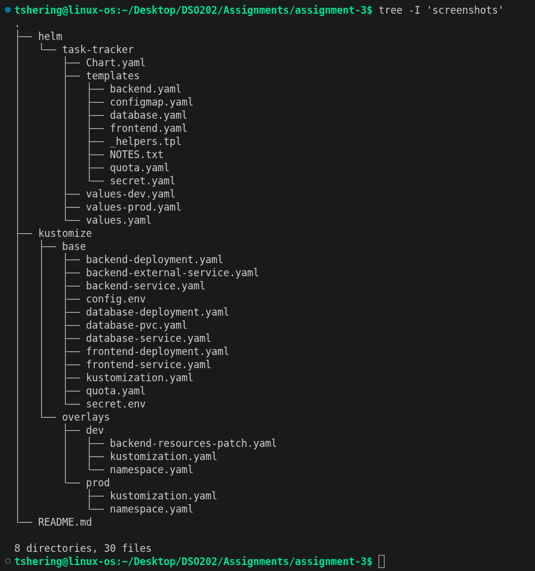
*Figure-3: Project directory tree*

## 4. Kustomize Implementation

### 4.1 Base and kustomization.yaml

The base lists the Assignment 1 manifests as `resources`, pins the three image tags with the `images` transformer, and adds a common label without touching selectors (`includeSelectors: false`, to avoid changing immutable selector fields). The `namespace:` fields were removed from the manifests so that each overlay decides the namespace.

The `configMapGenerator` and `secretGenerator` read `config.env` and `secret.env` and keep the original names `task-tracker-config` and `task-tracker-secret`. Kustomize appends a hash to each name and rewrites every `configMapKeyRef` / `secretKeyRef` in the Deployments, so the Deployments are identical to Assignment 1. A change to a value produces a new name and therefore a rolling update, which a plain `kubectl apply` of a changed ConfigMap does not do.

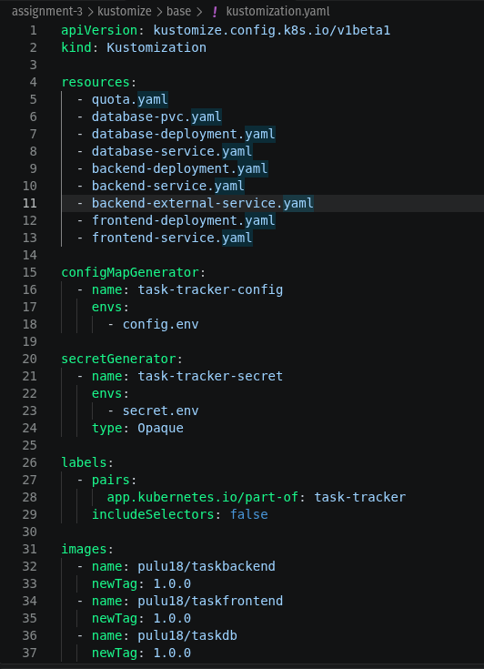
*Figure-4: `kustomize/base/kustomization.yaml`*

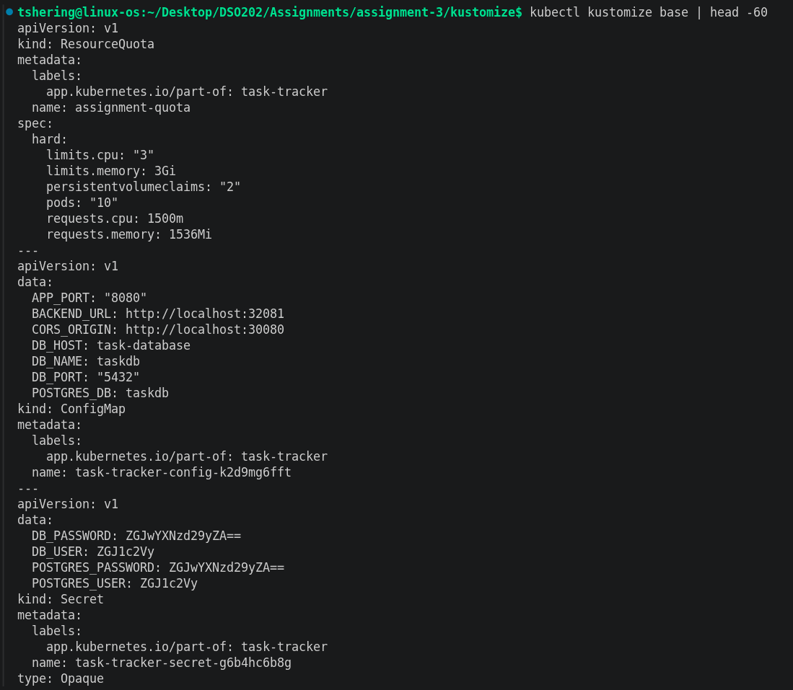
*Figure-5:`kubectl kustomize base` output (hashed ConfigMap and Secret names)*

### 4.2 Overlays and patches

| Overlay | Namespace | Patch type | Changes |
| --- | --- | --- | --- |
| dev | dso202-assignment-03-dev | Strategic merge patch | Backend requests 100m / 192Mi, limits 500m / 512Mi; label `environment: dev` |
| prod | dso202-assignment-03-prod | JSON patch (RFC 6902) + generator merge | Backend and frontend 2 replicas; NodePorts 30081 / 32082; `BACKEND_URL` and `CORS_ORIGIN` for ports 32082 / 8081; quota raised (CPU limit 6, pods 15) |

A strategic merge patch is a partial Deployment: Kustomize merges it by object name and merges the container list by container name, which suits changing one container's resources. A JSON patch addresses an exact path and operation, which suits replacing a single scalar such as `replicas` or `nodePort`. The prod quota is raised because two backend replicas already use the full 3-CPU limit of the Assignment 1 quota and a rolling update needs one extra pod.

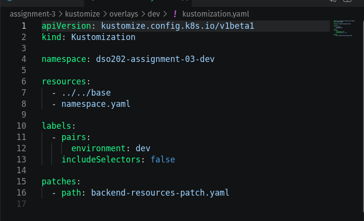

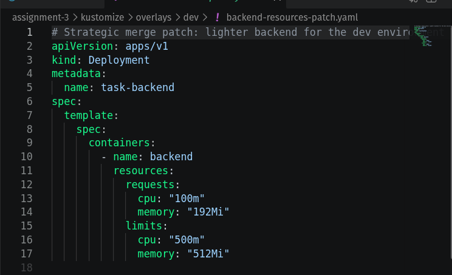
*Figure-6: dev overlay `kustomization.yaml` and `backend-resources-patch.yaml`*

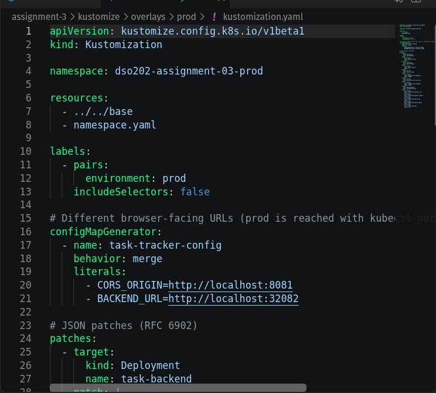
*Figure-7: prod overlay `kustomization.yaml` with the JSON patches*

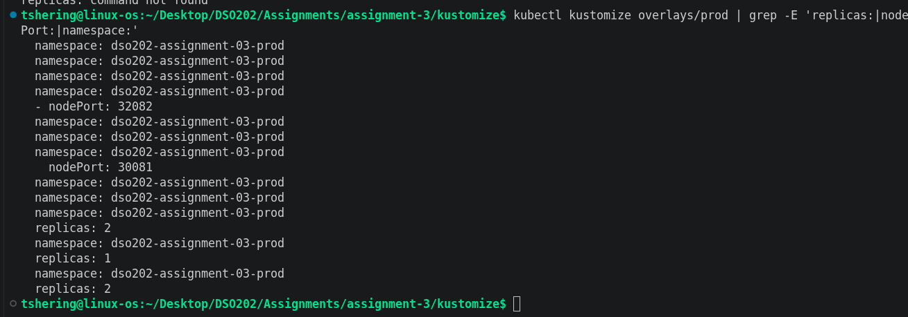
*Figure-8: `kubectl kustomize overlays/prod`*

### 4.3 Deployment with kubectl

#### dev

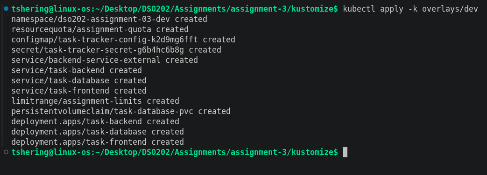
*Figure-9: `kubectl apply -k overlays/dev`*

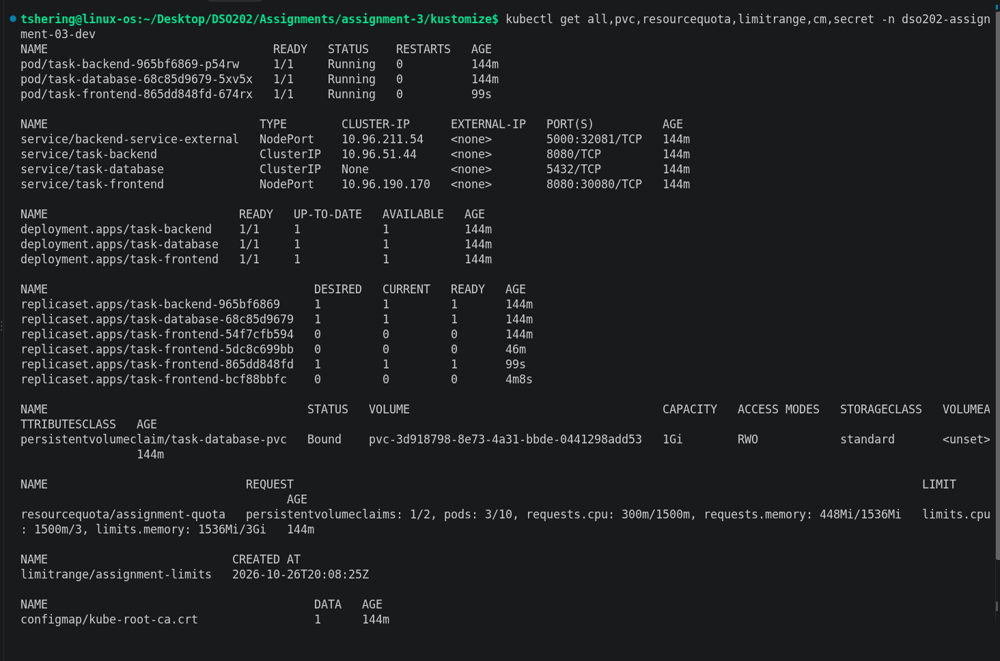 
*Figure-10: `kubectl get all,pvc,resourcequota,limitrange,cm,secret -n dso202-assignment-03-dev`*

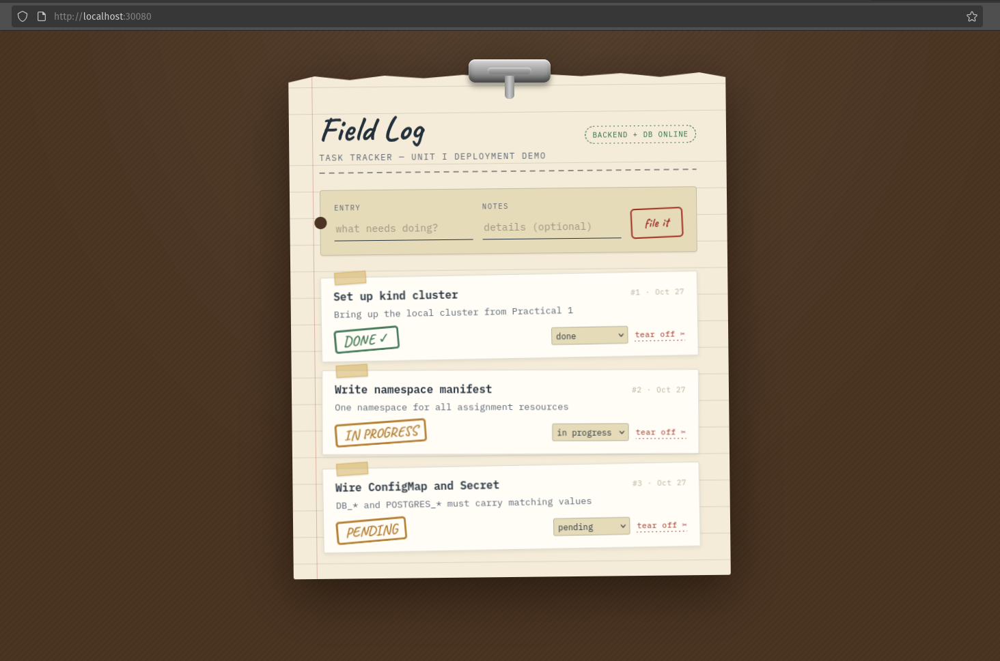
*Figure-11: Task Tracker UI at http://localhost:30080 (dev), including a created task*

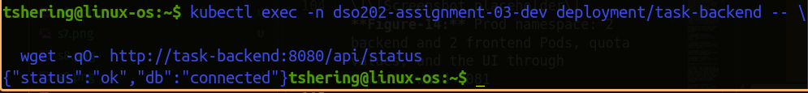
*Figure-12: Service DNS check from the frontend Pod (`wget http://task-backend:8080/api/status`)*

#### pod
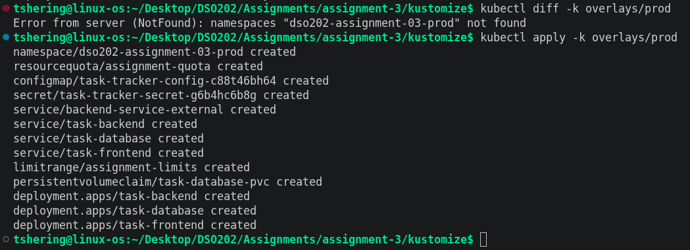
*Figure-13: `kubectl diff -k overlays/prod` and `kubectl apply -k overlays/prod`*

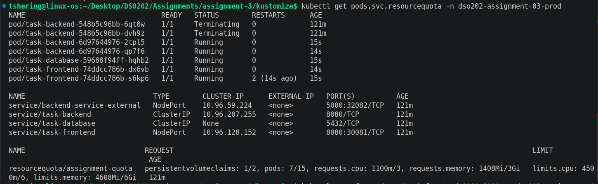
*Figure-14: `kubectl get pods,svc,resourcequota -n dso202-assignment-03-prod`*

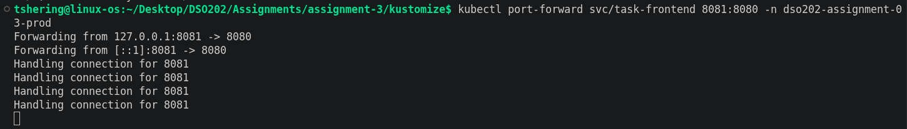
*Figure-15: `kubectl port-forward svc/task-frontend 8081:8080 -n dso202-assignment-03-prod`*

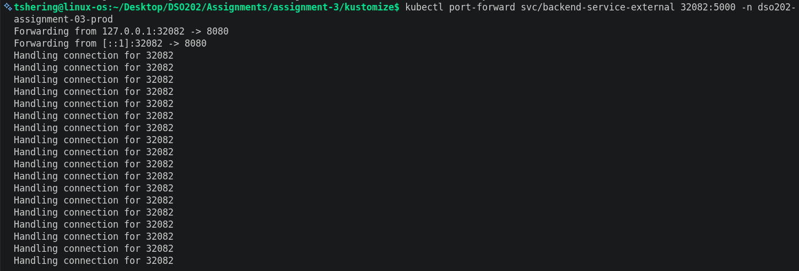
*Figure-16: `kubectl port-forward svc/backend-service-external 32082:5000 -n dso202-assignment-03-prod`*

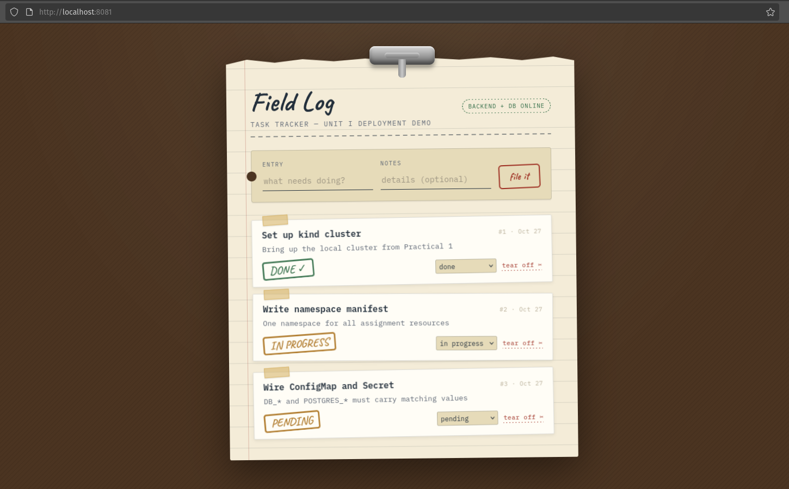
*Figure-17: Task Tracker UI at http://localhost:8081 (pod), including a created task*

### 4.4 Configuration change demonstration

A value in `config.env` was changed and the overlay re-applied. Kustomize generated a ConfigMap with a new hash, and the Deployments that reference it created a new ReplicaSet.

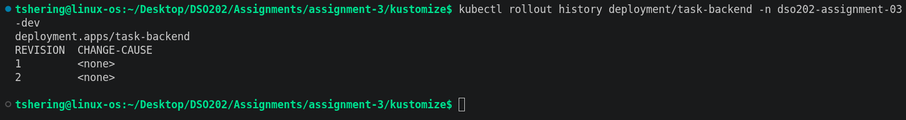
*Figure-18: Two ConfigMap names and `kubectl rollout history deployment/task-backend`*

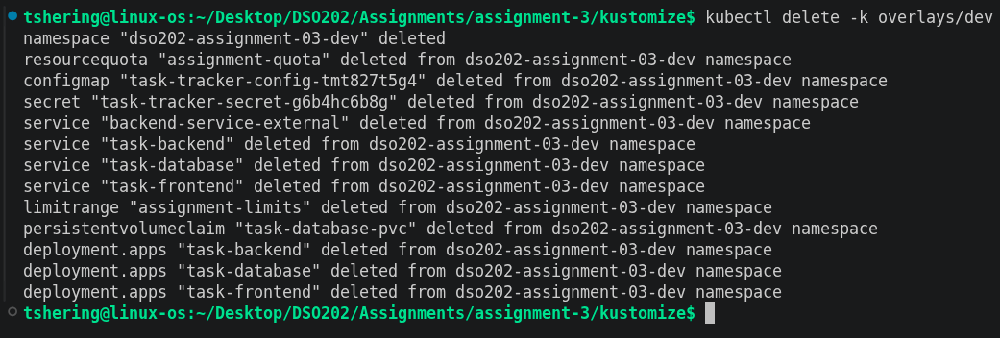
*Figure-19: kustomize overlay/dev deleted before starting the Helm.*

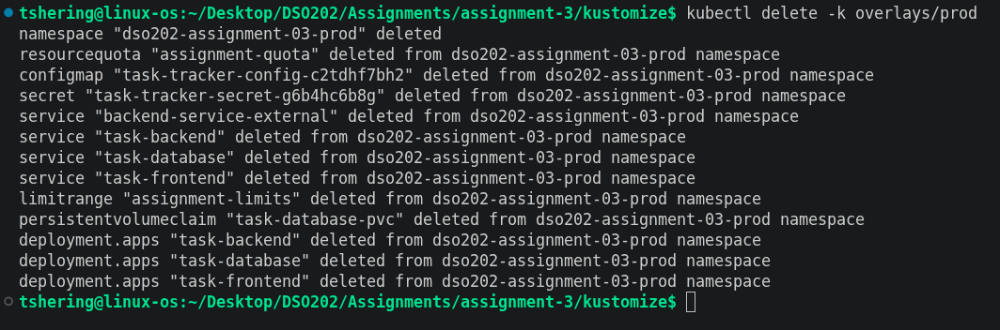
*Figure-20: kustomize overlay/pod deleted before starting the Helm.*

## 5. Helm Implementation

### 5.1 Chart structure and templates

The chart `task-tracker` (version 0.1.0, appVersion 1.0.0) renders ConfigMap, Secret, ResourceQuota, LimitRange, PVC, three Deployments and four Services. Defaults in `values.yaml` equal the Assignment 1 settings; `values-dev.yaml` and `values-prod.yaml` hold only the differences.

| Feature | Where used |
| --- | --- |
| Built-in objects `.Values`, `.Release`, `.Chart`, `.Template` | Names, labels, images, namespace in NOTES, config checksums |
| Named templates (`define` / `include`) | fullname, labels, selectorLabels, config and secret names |
| Functions `quote`, `default`, `trunc`, `toYaml`, `nindent`, `sha256sum`, `dict`, `list` | ConfigMap values, resources blocks, selector helper, config checksum |
| Flow control `range`, `if` | Backend environment variables, optional quota |

The database Service name is built from the release name and written into `DB_HOST`, so a release named `tt` produces `tt-database`. The config and secret checksums on pod annotations restart pods when those objects change.

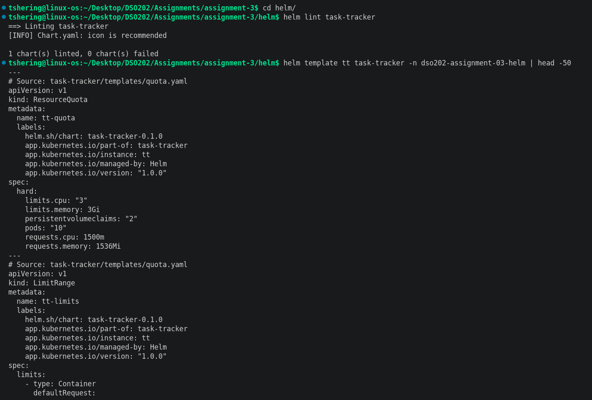
*Figure-21: `helm lint task-tracker` and `helm template tt task-tracker`*

### 5.2 Install

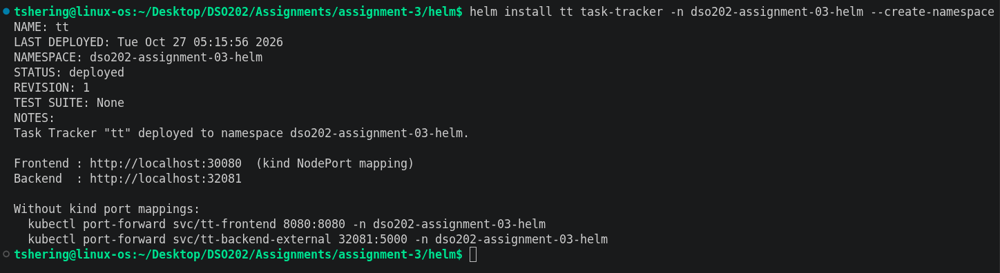
*Figure-22: `helm install tt ...` with the NOTES output*

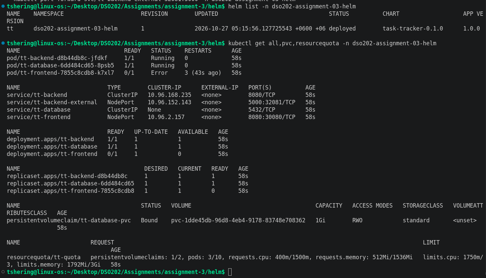
*Figure-23: `helm list` and `kubectl get all,pvc,resourcequota -n dso202-assignment-03-helm`*

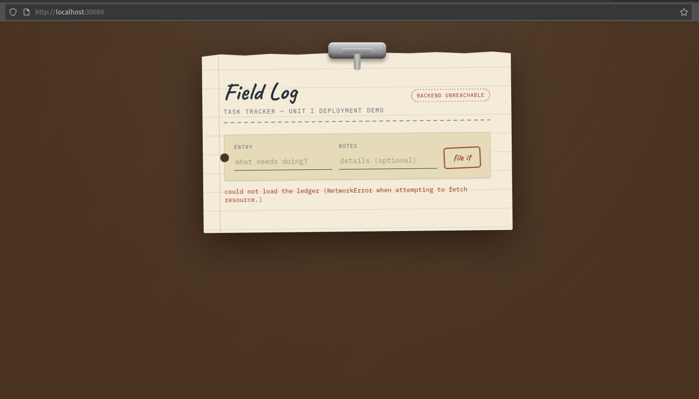
*Figure-24: Task Tracker UI from the Helm release*

### 5.3 Upgrade, history and rollback

| Revision | Command | Result |
| --- | --- | --- |
| 1 | `helm install tt` | Assignment 1 defaults, 1 replica per tier |
| 2 | `helm upgrade -f values-prod.yaml` | 2 + 2 replicas, raised quota, new NodePorts and URLs |
| 3 | `helm upgrade ... --set backend.image.tag=9.9.9` | New backend Pod in ImagePullBackOff; old Pods keep serving |
| 4 | `helm rollback tt 2` | Revision 2 restored, status deployed |

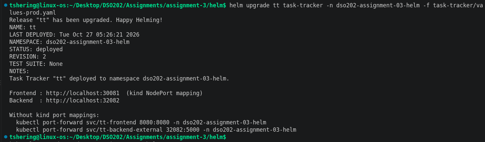
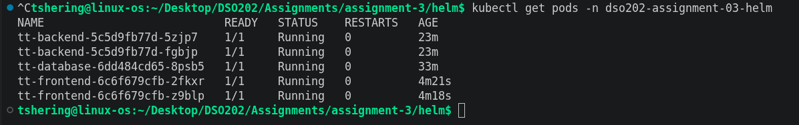
*Figure-25: `helm upgrade` (revision 2) and Pods after the upgrade*

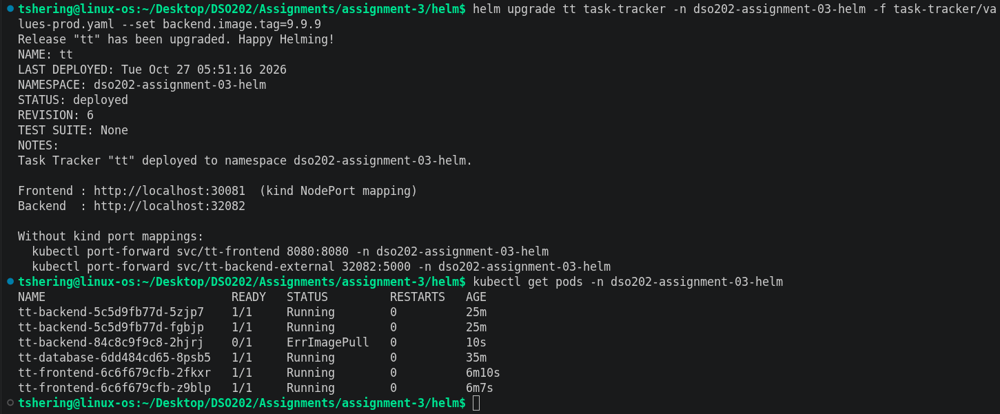
*Figure-26: Failed upgrade (revision 3): Pod in ImagePullBackOff*

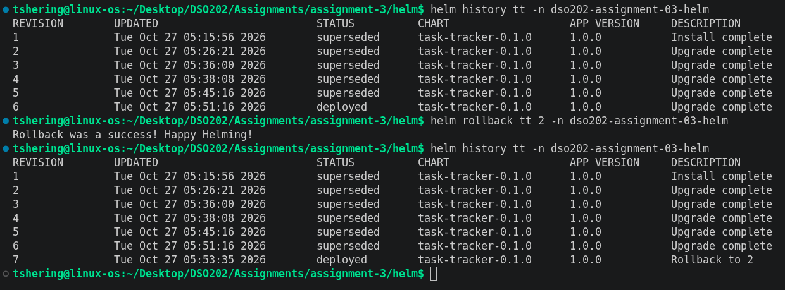
*Figure-27: `helm history tt` before and after `helm rollback tt 2`*

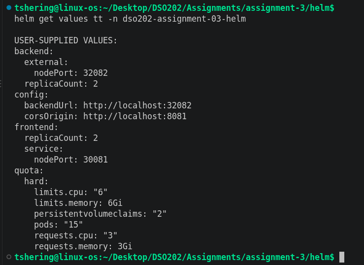
*Figure-28: Healthy Pods after rollback and `helm get values tt`*

### 5.4 Self-healing and persistence

As in Assignment 1, a task was created, the backend Pod was deleted, and the task was retrieved from the replacement Pod, showing that data lives in PostgreSQL on the PVC and that the Deployment restores the desired replica count.

During revision 3 the old backend pods keep serving (rolling update with maxUnavailable 25%), which is why the app stays reachable while the new pod fails.

## 6. etcd and Service Discovery

etcd is a distributed key-value store that uses the Raft consensus algorithm: a leader replicates writes to followers and a write is committed once a majority acknowledges it. Kubernetes keeps all cluster state in etcd under `/registry/...`; only the API server talks to it. Everything created in this assignment (Deployments, Services, Endpoints, ConfigMaps, Secrets) is therefore stored there. Services are discovered through CoreDNS names (for example `task-backend`), which are built from the Service and Endpoints objects stored in etcd. Helm also stores each release revision as a Secret (`sh.helm.release.v1.tt.vN`), so the history in section 5.3 is persisted in etcd.

The kind control plane runs a single etcd member, so the lab shows the tooling but not an actual leader election.

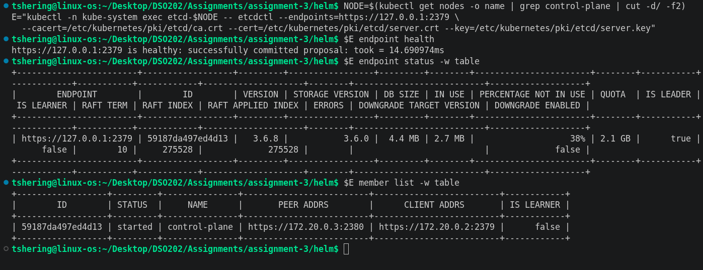
*Figure-29: `etcdctl endpoint health`, `endpoint status -w table`, `member list`*

### Application configuration in etcd

A key under `/task-tracker/config/` was written, read, watched and updated with `etcdctl`. A watcher received the update immediately, which shows how an application could reload settings without a redeploy. In this assignment the Task Tracker itself still reads its settings from the ConfigMap, because the application images are unchanged.

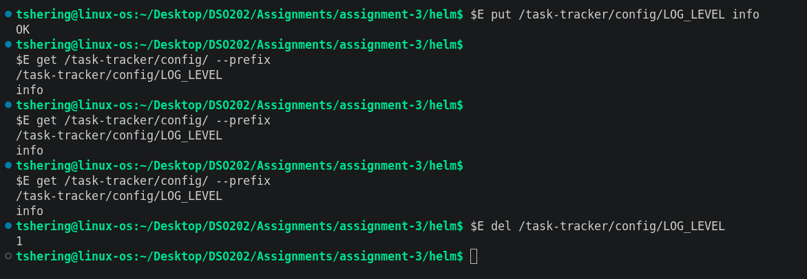
*Figure-30: `put`, `get --prefix` and a `watch` terminal showing the change*

### Backup, restore and security

Backup is a snapshot (`etcdctl snapshot save`). Restore uses `etcdctl snapshot restore` into a fresh data directory with etcd stopped, then the etcd manifest is pointed at that directory. etcd should be reachable only over TLS with client certificates, which is why every command above passes `--cacert`, `--cert` and `--key`; etcd also supports its own users and roles. Secrets in etcd are only base64 encoded unless encryption at rest is configured on the API server, as the Assignment 1 README also notes.

## 7. Comparison of Kustomize and Helm

| Aspect | Kustomize | Helm |
| --- | --- | --- |
| Approach | Patches and overlays on plain YAML | Go templates with values |
| Reuse of Assignment 1 files | Almost unchanged (namespace line removed) | Rewritten as templates |
| Environment differences | Overlays (strategic merge, JSON patches) | Values files and `--set` |
| ConfigMap/Secret handling | Generators with hashed names, automatic rollout | Templates plus checksum annotations |
| Release tracking | None; uses kubectl apply and Git | Numbered revisions, history, rollback |
| Packaging and sharing | Directory in Git | Versioned chart (`helm package`) |
| Readability | Always valid YAML | Template syntax mixed into YAML |
| Tooling | Built into `kubectl -k` | Separate binary |
| Naming | Fixed names, so `DB_HOST` stays `task-database` | Release-prefixed names, so `DB_HOST` must be templated |

**Observations from this assignment:** Kustomize needed the least change to the Assignment 1 manifests and made the dev/prod difference easy to read. Helm needed more work (templating names and `DB_HOST`) but gave one command to upgrade, inspect history and roll back, which Kustomize does not provide.

## 8. Integration, Best Practices and Version Control

- Keep one base and small overlays; do not copy manifests between environments.
- Do not commit real credentials. `secret.env` is git-ignored, and `values.yaml` holds lab values only. For real use, take secrets from a secret manager or sealed secrets.
- Pin image tags and chart versions; avoid `latest`.
- Validate before applying: `kubectl kustomize`, `kubectl diff -k`, `helm lint`, `helm template`.
- Keep quotas consistent with replica counts and rolling-update surge, as found in the prod overlay.
- The tools combine: `helm template tt task-tracker > rendered.yaml` can be listed as a resource in a Kustomize overlay to patch a chart's output without editing the chart.
- Keep the base, overlays and chart in Git, commit them separately, tag releases (`v0.1.0`), and use pull requests for changes. Etcd snapshots complement Git: Git holds the desired state, etcd the live state.

## 9. Challenges and Solutions

| Challenge | Solution |
| --- | --- |
| NodePorts 30080 / 32081 are the only host ports mapped by kind | Ran one environment at a time; prod uses port-forward with matching `BACKEND_URL` / `CORS_ORIGIN` |
| The frontend calls the backend from the browser | Overrode `BACKEND_URL` and `CORS_ORIGIN` per environment (merge generator in Kustomize, values in Helm) |
| Two backend replicas reach the 3-CPU quota limit, blocking rolling updates | Raised the quota in the prod overlay and `values-prod.yaml` |
| `DB_HOST` is a plain string, not rewritten by name prefixes | Kept fixed names in Kustomize; templated `DB_HOST` from the release name in Helm |

## 10. Conclusion

Kustomize reproduced the Assignment 1 deployment with almost no change to the original manifests and added generators, two kinds of patches and per-environment namespaces. Helm packaged the same application into a parameterised chart with tracked revisions, upgrade and rollback. etcd stores everything both tools create, and its health, keys and snapshots can be inspected with `etcdctl`. Kustomize suits environment variations of an application you own, while Helm suits versioned releases and rollback; with both configurations kept in Git, they give a repeatable and auditable deployment.

## 11. References

- Kubernetes documentation: Declarative management using Kustomize, https://kubernetes.io/docs/tasks/manage-kubernetes-objects/kustomization/
- Helm documentation, https://helm.sh/docs/
- etcd documentation, https://etcd.io/docs/
- Kubernetes documentation: Operating etcd clusters, https://kubernetes.io/docs/tasks/administer-cluster/configure-upgrade-etcd/
- DSO202 Unit 4 lecture notes
