# Evidence Log — DSO202 Assignment 4

Command output for every task, in the order the brief requires.

## Task 1 — Repository, Chart Contract and Cluster

### Tool check (section 3.2)

```text
$ docker version --format '{{.Server.Version}}'
29.4.0
$ kind version
kind v0.32.0 go1.26.3 linux/amd64
$ kubectl version --client
Client Version: v1.34.1
Kustomize Version: v5.7.1
$ helm version --short
v3.22.1+gd6c1a0e
$ git --version
git version 2.34.1
$ argocd version --client
argocd: v3.5.6+c2b1e30
  GoVersion: go1.26.10
  Platform: linux/amd64
$ kubeseal --version
kubeseal version: 0.40.0
```

Sealed Secrets Helm repository check:

```text
$ helm repo add sealed-secrets https://bitnami.github.io/sealed-secrets
$ helm repo update
$ helm search repo sealed-secrets/sealed-secrets --versions | head -5
```
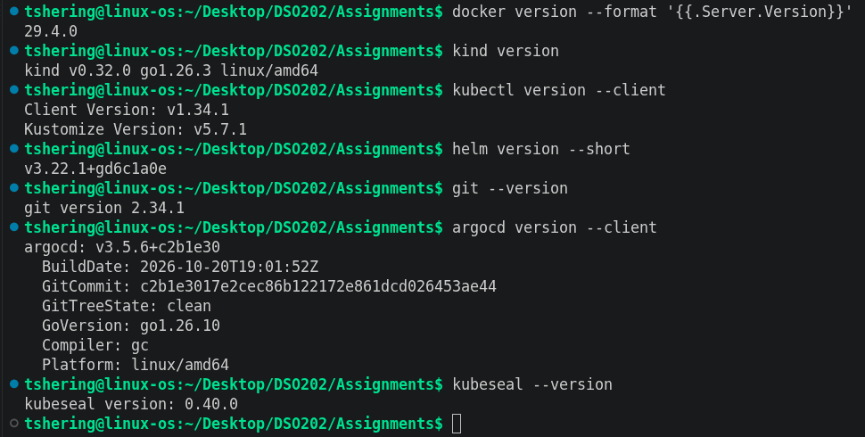  

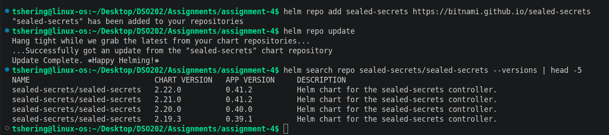  

### Chart contract (C1–C11)

| # | Requirement | Satisfied where |
| --- | --- | --- |
| C1 | Image repo/tag are values | `charts/tasktracker/values.yaml` (`frontend.image`, `backend.image`, `database.image`); overridden per environment in `environments/<env>/values.yaml` |
| C2 | Per-tier config from values, no template edit needed | `charts/tasktracker/templates/configmap.yaml` reads `.Values.config.*`; backend/frontend env vars read the rendered ConfigMap |
| C3 | No Secret rendered; `existingSecret: tasktracker-credentials` | `charts/tasktracker/values.yaml` (`existingSecret`), used via `task-tracker.secretName` helper in `_helpers.tpl`; `templates/secret.yaml` deleted |
| C4 | Readiness probes, backend `GET /api/status` | `templates/backend.yaml` (`httpGet /api/status`), `templates/frontend.yaml` (`httpGet /`), `templates/database.yaml` (`tcpSocket`) |
| C5 | `sync-wave` db=0, backend=1, frontend=2 | `templates/database.yaml`, `templates/backend.yaml`, `templates/frontend.yaml` annotations |
| C6 | `progressDeadlineSeconds: 120` | `templates/backend.yaml`, `templates/frontend.yaml` Deployment spec |
| C7 | Requests/limits on every container | every container in `templates/*.yaml` and the smoke-test Job |
| C8 | No Namespace/ResourceQuota/LimitRange/Role/RoleBinding rendered | confirmed by `helm template \| grep kind:` (Task 1, step 6) — only ConfigMap, Deployment, Job, PersistentVolumeClaim, Service appear |
| C9 | Ingress disabled by default if present | chart has no Ingress template; not applicable |
| C10 | Frontend Service `NodePort`, port a value (30080 dev / 30081 staging) | `templates/frontend.yaml` Service; `environments/dev/values.yaml` and `environments/staging/values.yaml` (`frontend.service.nodePort`) |
| C11 | `helm lint` clean; `helm template` succeeds for both envs | see below |

### `helm lint` (both environments)

```text
$ helm lint charts/tasktracker -f environments/dev/values.yaml
==> Linting charts/tasktracker
[INFO] Chart.yaml: icon is recommended

1 chart(s) linted, 0 chart(s) failed

$ helm lint charts/tasktracker -f environments/staging/values.yaml
==> Linting charts/tasktracker
[INFO] Chart.yaml: icon is recommended

1 chart(s) linted, 0 chart(s) failed
```

### Rendered kinds (both environments identical)

```text
$ helm template tasktracker charts/tasktracker -f environments/dev/values.yaml | grep '^kind:' | sort | uniq -c
      1 kind: ConfigMap
      3 kind: Deployment
      1 kind: Job
      1 kind: PersistentVolumeClaim
      4 kind: Service

$ helm template tasktracker charts/tasktracker -f environments/staging/values.yaml | grep '^kind:' | sort | uniq -c
      1 kind: ConfigMap
      3 kind: Deployment
      1 kind: Job
      1 kind: PersistentVolumeClaim
      4 kind: Service
```

### Cluster creation

```text
$ kind get clusters
dso202-assignment-01

$ kind delete cluster --name dso202-assignment-01
Deleting cluster "dso202-assignment-01" ...
Deleted nodes: ["dso202-assignment-01-worker2" "dso202-assignment-01-control-plane" "dso202-assignment-01-worker"]

$ kind create cluster --name dso202-gitops --config cluster/kind-cluster.yaml
Creating cluster "dso202-gitops" ...
 ✓ Ensuring node image (kindest/node:v1.36.1)
 ✓ Preparing nodes
 ✓ Writing configuration
 ✓ Starting control-plane
 ✓ Installing CNI
 ✓ Installing StorageClass
 ✓ Joining worker nodes
Set kubectl context to "kind-dso202-gitops"

$ kubectl config current-context
kind-dso202-gitops

$ kubectl get nodes
NAME            STATUS   ROLES           AGE   VERSION
control-plane   Ready    control-plane   30s   v1.36.1
worker-node-1   Ready    <none>          17s   v1.36.1
worker-node-2   Ready    <none>          17s   v1.36.1

$ docker ps --filter name=dso202-gitops --format '{{.Names}}   {{.Ports}}'
dso202-gitops-worker
dso202-gitops-worker2
dso202-gitops-control-plane   127.0.0.1:30080->30080/tcp, 127.0.0.1:41115->6443/tcp
```

## Task 2 — Install Argo CD Declaratively

### Render check (step 2)

```text
$ kubectl kustomize bootstrap/argocd | grep -E '^kind: (Deployment|StatefulSet)$' | sort | uniq -c
      6 kind: Deployment
      1 kind: StatefulSet

$ kubectl kustomize bootstrap/argocd | grep 'image:' | sort -u
        image: ghcr.io/dexidp/dex:v2.45.1
        image: public.ecr.aws/docker/library/redis:8.2.3-alpine
        image: quay.io/argoproj/argocd:v3.5.6
```

Matches expectations exactly: 6 Deployments, 1 StatefulSet, no Docker Hub image, Argo CD pinned to v3.5.6.

### Apply (step 3) and readiness (step 4)

```text
$ kubectl apply -k bootstrap/argocd --server-side --force-conflicts
namespace/argocd serverside-applied
customresourcedefinition.apiextensions.k8s.io/applications.argoproj.io serverside-applied
customresourcedefinition.apiextensions.k8s.io/applicationsets.argoproj.io serverside-applied
customresourcedefinition.apiextensions.k8s.io/appprojects.argoproj.io serverside-applied
... (62 objects total: namespace, 3 CRDs, ServiceAccounts, Roles/RoleBindings,
     ClusterRoles/ClusterRoleBindings, ConfigMaps, Secrets, Services,
     Deployments, the application-controller StatefulSet, NetworkPolicies)

$ kubectl wait --for=condition=Available deployment --all -n argocd --timeout=600s
deployment.apps/argocd-applicationset-controller condition met
deployment.apps/argocd-dex-server condition met
deployment.apps/argocd-notifications-controller condition met
deployment.apps/argocd-redis condition met
deployment.apps/argocd-repo-server condition met
deployment.apps/argocd-server condition met

$ kubectl rollout status statefulset/argocd-application-controller -n argocd --timeout=600s
partitioned roll out complete: 1 new pods have been updated...

$ kubectl get pods -n argocd
NAME                                                READY   STATUS    RESTARTS   AGE
argocd-application-controller-0                     1/1     Running   0          25m
argocd-applicationset-controller-58bb5c7479-gf7hc   1/1     Running   0          25m
argocd-dex-server-dd6b85d9c-2btvf                   1/1     Running   0          25m
argocd-notifications-controller-6b85c65458-8ckjb    1/1     Running   0          25m
argocd-redis-869b85489d-cx4mw                       1/1     Running   0          25m
argocd-repo-server-5bf66565cd-9rmjg                 1/1     Running   0          25m
argocd-server-7474bb8f76-x4tz9                      1/1     Running   0          25m

$ kubectl get crd | grep argoproj.io
applications.argoproj.io      2026-11-18T11:40:26Z
applicationsets.argoproj.io   2026-11-18T11:40:27Z
appprojects.argoproj.io       2026-11-18T11:40:27Z
```

Note: the first sync took ~25 minutes on this network because every node had
to pull `quay.io/argoproj/argocd:v3.5.6` (222 MB) independently — this was a
slow/shared connection, not a configuration fault; no pod ever reported a
real error, only transient `CreateContainerConfigError` while
`argocd-redis`'s `redis-initial-password` init container was still pulling
its own image copy.

### Sign-in (step 5)

```text
$ kubectl port-forward svc/argocd-server -n argocd 8080:443
Forwarding from 127.0.0.1:8080 -> 8080
Forwarding from [::1]:8080 -> 8080

$ argocd admin initial-password -n argocd
<redacted – rotated with `argocd account update-password`; never recorded>
This password must be only used for first time login. We strongly recommend
you update the password using `argocd account update-password`.

$ argocd login localhost:8080 --username admin --insecure
'admin:login' logged in successfully
Context 'localhost:8080' updated
```
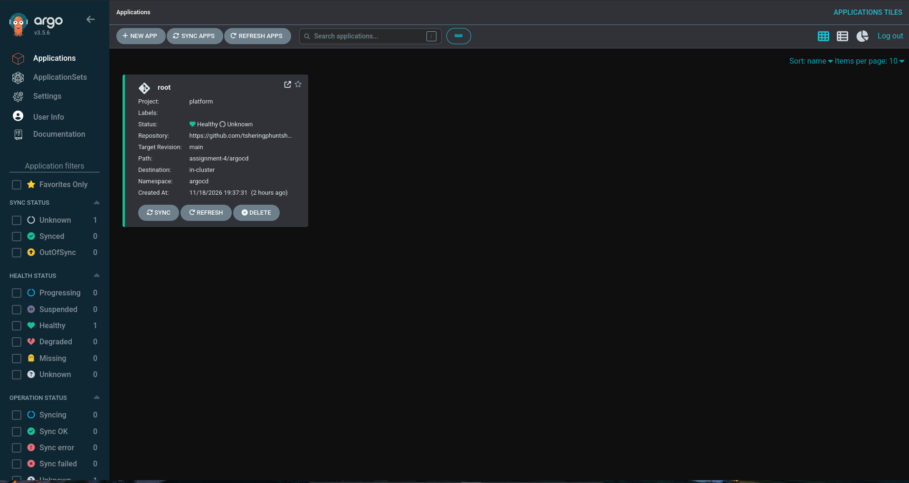  

### Local settings confirmation (step 6)

```text
$ kubectl get configmap argocd-cm -n argocd -o yaml | grep -E 'timeout.reconciliation|accounts.reviewer'
  accounts.reviewer: login
  timeout.reconciliation: 60s
  timeout.reconciliation.jitter: 10s

$ argocd version
argocd: v3.5.6+c2b1e30
argocd-server: v3.5.6
```
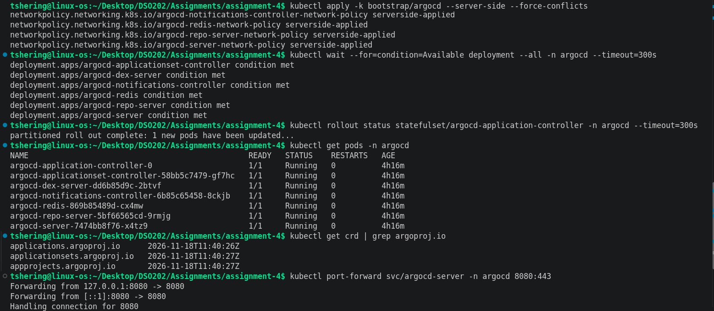  
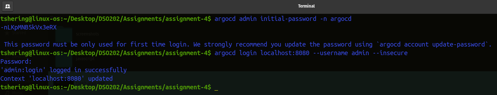    

## Task 3 — AppProjects and the Root Application

### Step 5 checks

```text
$ kubectl get appproject,application -n argocd
NAME                              AGE
appproject.argoproj.io/default    6h6m
appproject.argoproj.io/dso202     9m21s
appproject.argoproj.io/platform   4h19m

NAME                           SYNC STATUS   HEALTH STATUS
application.argoproj.io/root   Synced        Healthy

$ argocd app get root
Name:               argocd/root
Project:            platform
Server:             https://kubernetes.default.svc
Namespace:          argocd
URL:                https://localhost:8080/applications/root
Source:
- Repo:             https://github.com/tsheringphuntsho18/DSO202_Assigments_AS2026.git
  Target:           main
  Path:             assignment-4/argocd
SyncWindow:         Sync Allowed
Sync Policy:        Automated (Prune)
Sync Status:        Synced to main (30cd172)
Health Status:      Healthy

GROUP        KIND        NAMESPACE  NAME    STATUS  HEALTH  HOOK  MESSAGE
argoproj.io  AppProject  argocd     dso202  Synced                appproject.argoproj.io/dso202 unchanged

$ argocd proj get dso202
Name:                        dso202
Description:                 Task Tracker workloads for the dev and staging environments
Destinations:                https://kubernetes.default.svc,dso202-dev
                             https://kubernetes.default.svc,dso202-staging
Repositories:                https://github.com/tsheringphuntsho18/DSO202_Assigments_AS2026.git
Source Namespaces:           <none>
Scoped Repositories:         <none>
Allowed Cluster Resources:   <none>
Scoped Clusters:             <none>
Denied Namespaced Resources: <none>
Signature keys:              <none>
Orphaned Resources:          disabled
```
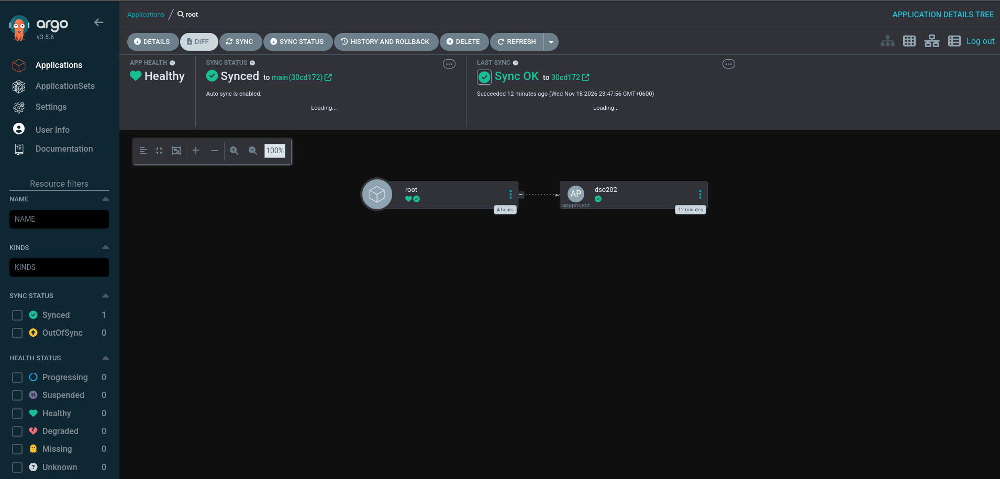  

### Final `dso202` whitelist

From `argocd/projects/dso202.yaml`. The list is derived from `helm template`
for both environments (Task 1, step 6):

| Group | Kind | Note |
| --- | --- | --- |
| `apps` | Deployment | baseline |
| `""` | Service | baseline |
| `""` | ConfigMap | baseline |
| `batch` | Job | baseline (PostSync smoke test) |
| `""` | PersistentVolumeClaim | **added**: the database tier's PVC (`templates/database.yaml`) is rendered by this chart |

`clusterResourceWhitelist: []` means no cluster-scoped kinds are allowed.
ResourceQuota, LimitRange, Role, RoleBinding and SealedSecret are deliberately
absent; they belong to the `platform` project.

## Task 4 — Platform Layer and Sealed Secrets

### Step 1: controller delivered through Git

```text
$ argocd app get sealed-secrets
Name:               argocd/sealed-secrets
Project:            platform
Server:             https://kubernetes.default.svc
Namespace:          sealed-secrets
URL:                https://localhost:8080/applications/sealed-secrets
Source:
- Repo:             https://bitnami.github.io/sealed-secrets
  Target:           2.20.0
SyncWindow:         Sync Allowed
Sync Policy:        Automated (Prune)
Sync Status:        Synced to 2.20.0
Health Status:      Healthy

GROUP                      KIND                      NAMESPACE       NAME                                       STATUS  HEALTH   HOOK  MESSAGE
                           Service                   sealed-secrets  sealed-secrets-controller                  Synced  Healthy        service/sealed-secrets-controller configured
                           Service                   sealed-secrets  sealed-secrets-controller-metrics          Synced  Healthy        service/sealed-secrets-controller-metrics configured
apps                       Deployment                sealed-secrets  sealed-secrets-controller                  Synced  Healthy        deployment.apps/sealed-secrets-controller configured
                           ServiceAccount            sealed-secrets  sealed-secrets-controller                  Synced                 
apiextensions.k8s.io       CustomResourceDefinition                  sealedsecrets.bitnami.com                  Synced  Healthy        
rbac.authorization.k8s.io  ClusterRole                               secrets-unsealer                           Synced                 
rbac.authorization.k8s.io  ClusterRoleBinding                        sealed-secrets-controller                  Synced                 
rbac.authorization.k8s.io  Role                      sealed-secrets  sealed-secrets-controller-key-admin        Synced                 
rbac.authorization.k8s.io  Role                      sealed-secrets  sealed-secrets-controller-service-proxier  Synced                 
rbac.authorization.k8s.io  RoleBinding               sealed-secrets  sealed-secrets-controller-key-admin        Synced                 
rbac.authorization.k8s.io  RoleBinding               sealed-secrets  sealed-secrets-controller-service-proxier  Synced  

$ kubectl get pods -n sealed-secrets
NAME                                        READY   STATUS    RESTARTS   AGE
sealed-secrets-controller-8b5ffdf69-pjc7r   1/1     Running   0          6m3s

$ kubectl get crd sealedsecrets.bitnami.com
NAME                        CREATED AT
sealedsecrets.bitnami.com   2026-11-18T19:17:33Z
```
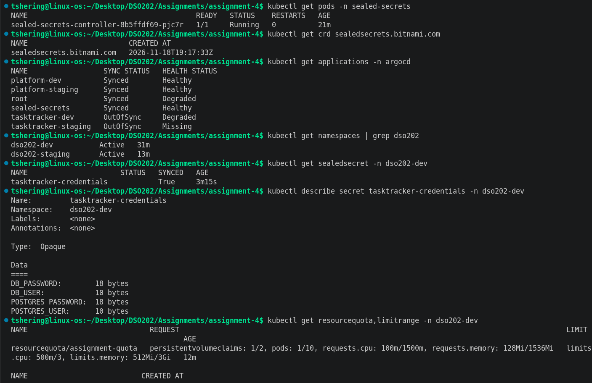

### Sealing-key backup (existence and permissions only)

```text
$ ls -ld ../dso202-keys && ls -l ../dso202-keys/
drwxrwxr-x 2 tshering tshering 4096 Nov 18 22:42 ../dso202-keys
total 4
-rw------- 1 tshering tshering 68 Nov 18 22:42 sealing-key.backup.yaml
```

The key's contents are never shown. A second copy is kept offline.

### Step 6: decryption checks

```text
$ kubectl get sealedsecret,secret -n dso202-dev
NAME                                               STATUS   SYNCED   AGE
sealedsecret.bitnami.com/tasktracker-credentials            True     5m17s

NAME                             TYPE     DATA   AGE
secret/tasktracker-credentials   Opaque   4      5m17s

$ kubectl get sealedsecret,secret -n dso202-staging
NAME                                               STATUS   SYNCED   AGE
sealedsecret.bitnami.com/tasktracker-credentials            True     9m50s

NAME                             TYPE     DATA   AGE
secret/tasktracker-credentials   Opaque   4      9m50s
```

### Step 7: plaintext searches (keys tested, not values)

```text
$ git log --all -p -- assignment-4 | grep -nE '^\+.*(DB_PASSWORD|POSTGRES_PASSWORD): ' ; echo "exit=$?"
exit=1

$ git log --all -p -- assignment-4 | grep -nE '^\+kind: Secret$' ; echo "exit=$?"
exit=1

$ git log --all -p | grep -n 'BEGIN .*PRIVATE KEY' ; echo "exit=$?"
exit=1

$ git check-ignore -v assignment-4/x.key assignment-4/sealing-key.backup.yaml assignment-4/dev-plain.yaml
assignment-4/.gitignore:9:*.key assignment-4/x.key
assignment-4/.gitignore:11:*.backup.yaml        assignment-4/sealing-key.backup.yaml
assignment-4/.gitignore:15:*-plain.yaml assignment-4/dev-plain.yaml
```

### Platform Applications

```text
$ argocd app list
NAME         CLUSTER                         NAMESPACE  PROJECT   STATUS   HEALTH   SYNCPOLICY  CONDITIONS       REPO                                           PATH                 TARGET
argocd/root  https://kubernetes.default.svc  argocd     platform  Unknown  Healthy  Auto-Prune  ComparisonError  https://github.com/tsheringphuntsho18/DSO202_Assigments_AS2026.git  assignment-4/argocd  main
```
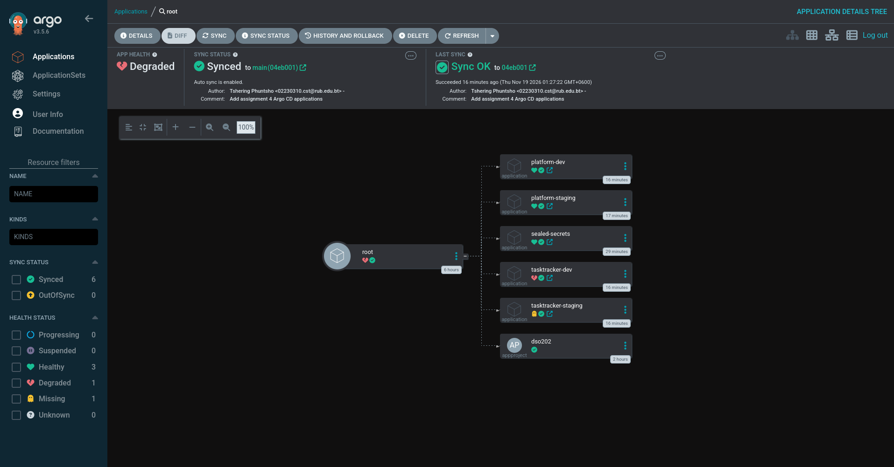

## Task 5 — Deliver the Workloads to dev and staging

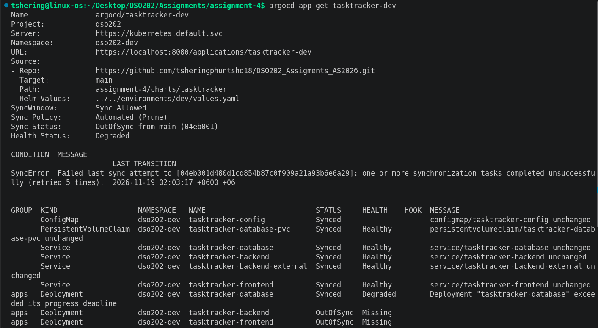    

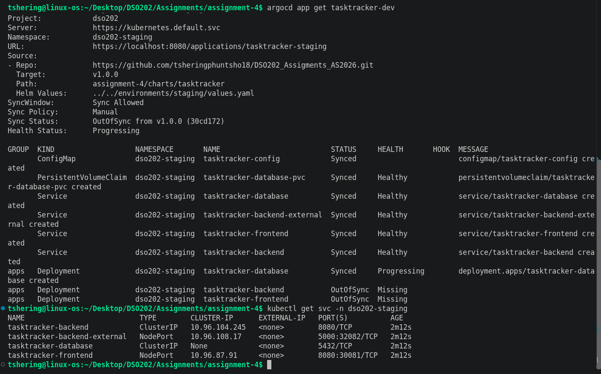

## Task 6 — Access Control for Argo CD Users

### Accounts

```text
$ argocd account list
NAME      ENABLED  CAPABILITIES
admin     true     login
reviewer  true     login
```

### Step 3: reviewer permission checks (signed in as reviewer)

```text
$ argocd login localhost:8080 --username reviewer --insecure
$ argocd app list
NAME                        CLUSTER                         NAMESPACE       PROJECT   STATUS     HEALTH       SYNCPOLICY  CONDITIONS  REPO                                                                PATH                             TARGET
argocd/platform-dev         https://kubernetes.default.svc  dso202-dev      platform  Synced     Healthy      Auto-Prune  <none>      https://github.com/tsheringphuntsho18/DSO202_Assigments_AS2026.git  assignment-4/platform/dev        main
argocd/platform-staging     https://kubernetes.default.svc  dso202-staging  platform  Synced     Healthy      Auto-Prune  <none>      https://github.com/tsheringphuntsho18/DSO202_Assigments_AS2026.git  assignment-4/platform/staging    main
argocd/root                 https://kubernetes.default.svc  argocd          platform  Synced     Degraded     Auto-Prune  <none>      https://github.com/tsheringphuntsho18/DSO202_Assigments_AS2026.git  assignment-4/argocd              main
argocd/sealed-secrets       https://kubernetes.default.svc  sealed-secrets  platform  Synced     Healthy      Auto-Prune  <none>      https://bitnami.github.io/sealed-secrets                                                             2.20.0
argocd/tasktracker-dev      https://kubernetes.default.svc  dso202-dev      dso202    OutOfSync  Degraded     Auto-Prune  SyncError   https://github.com/tsheringphuntsho18/DSO202_Assigments_AS2026.git  assignment-4/charts/tasktracker  main
argocd/tasktracker-staging  https://kubernetes.default.svc  dso202-staging  dso202    OutOfSync  Progressing  Manual      <none>      https://github.com/tsheringphuntsho18/DSO202_Assigments_AS2026.git  assignment-4/charts/tasktracker  v1.0.0

$ argocd app get root
Name:               argocd/root
Project:            platform
Server:             https://kubernetes.default.svc
Namespace:          argocd
URL:                https://localhost:8080/applications/root
Source:
- Repo:             https://github.com/tsheringphuntsho18/DSO202_Assigments_AS2026.git
  Target:           main
  Path:             assignment-4/argocd
SyncWindow:         Sync Allowed
Sync Policy:        Automated (Prune)
Sync Status:        Synced to main (04eb001)
Health Status:      Degraded

GROUP        KIND         NAMESPACE  NAME                 STATUS  HEALTH       HOOK  MESSAGE
argoproj.io  Application  argocd     sealed-secrets       Synced  Healthy            application.argoproj.io/sealed-secrets configured
argoproj.io  Application  argocd     platform-dev         Synced  Healthy            application.argoproj.io/platform-dev created
argoproj.io  Application  argocd     platform-staging     Synced  Healthy            application.argoproj.io/platform-staging configured
argoproj.io  Application  argocd     tasktracker-dev      Synced  Degraded           application.argoproj.io/tasktracker-dev created
argoproj.io  Application  argocd     tasktracker-staging  Synced  Progressing        application.argoproj.io/tasktracker-staging created
argoproj.io  AppProject   argocd     dso202               Synced        

$ argocd app sync tasktracker-dev
TIMESTAMP                  GROUP        KIND              NAMESPACE                  NAME            STATUS    HEALTH         HOOK  MESSAGE
2026-11-19T02:11:12+06:00          ConfigMap             dso202-dev    tasktracker-config            Synced                         
2026-11-19T02:11:12+06:00         PersistentVolumeClaim  dso202-dev  tasktracker-database-pvc        Synced   Healthy               
2026-11-19T02:11:12+06:00            Service             dso202-dev  tasktracker-frontend            Synced   Healthy               
2026-11-19T02:11:12+06:00   apps  Deployment             dso202-dev   tasktracker-backend          OutOfSync  Missing               
2026-11-19T02:11:12+06:00   apps  Deployment             dso202-dev  tasktracker-database            Synced   Degraded              
2026-11-19T02:11:12+06:00            Service             dso202-dev   tasktracker-backend            Synced   Healthy               
2026-11-19T02:11:12+06:00            Service             dso202-dev  tasktracker-backend-external    Synced   Healthy               
2026-11-19T02:11:12+06:00            Service             dso202-dev  tasktracker-database            Synced   Healthy               
2026-11-19T02:11:12+06:00   apps  Deployment             dso202-dev  tasktracker-frontend          OutOfSync  Missing               
2026-11-19T02:11:14+06:00          ConfigMap             dso202-dev    tasktracker-config            Synced                        configmap/tasktracker-config unchanged
2026-11-19T02:11:14+06:00         PersistentVolumeClaim  dso202-dev  tasktracker-database-pvc        Synced  Healthy               persistentvolumeclaim/tasktracker-database-pvc unchanged
2026-11-19T02:11:14+06:00   apps  Deployment             dso202-dev  tasktracker-database            Synced  Degraded              deployment.apps/tasktracker-database unchanged
2026-11-19T02:11:14+06:00            Service             dso202-dev  tasktracker-backend-external    Synced  Healthy               service/tasktracker-backend-external unchanged
2026-11-19T02:11:14+06:00            Service             dso202-dev  tasktracker-database            Synced  Healthy               service/tasktracker-database unchanged
2026-11-19T02:11:14+06:00            Service             dso202-dev   tasktracker-backend            Synced  Healthy               service/tasktracker-backend unchanged
2026-11-19T02:11:14+06:00            Service             dso202-dev  tasktracker-frontend            Synced  Healthy               service/tasktracker-frontend unchanged
2026-11-19T02:11:14+06:00   apps  Deployment  dso202-dev  tasktracker-database    Synced  Degraded              Deployment "tasktracker-database" exceeded its progress deadline
```
## Task 7 — A Release, a Faulty Release, and Recovery

### Step 5: dev during the faulty release (backend 1.1)

```text
$ argocd app get tasktracker-dev
Name:               argocd/tasktracker-dev
Project:            dso202
Server:             https://kubernetes.default.svc
Namespace:          dso202-dev
URL:                https://localhost:8080/applications/tasktracker-dev
Source:
- Repo:             https://github.com/tsheringphuntsho18/DSO202_Assigments_AS2026.git
  Target:           main
  Path:             assignment-4/charts/tasktracker
  Helm Values:      ../../environments/dev/values.yaml
SyncWindow:         Sync Allowed
Sync Policy:        Automated (Prune)
Sync Status:        OutOfSync from main (04eb001)
Health Status:      Degraded

GROUP  KIND                   NAMESPACE   NAME                          STATUS     HEALTH    HOOK  MESSAGE
       ConfigMap              dso202-dev  tasktracker-config            Synced                     configmap/tasktracker-config unchanged
       PersistentVolumeClaim  dso202-dev  tasktracker-database-pvc      Synced     Healthy         persistentvolumeclaim/tasktracker-database-pvc unchanged
       Service                dso202-dev  tasktracker-backend-external  Synced     Healthy         service/tasktracker-backend-external unchanged
       Service                dso202-dev  tasktracker-database          Synced     Healthy         service/tasktracker-database unchanged
       Service                dso202-dev  tasktracker-backend           Synced     Healthy         service/tasktracker-backend unchanged
       Service                dso202-dev  tasktracker-frontend          Synced     Healthy         service/tasktracker-frontend unchanged
apps   Deployment             dso202-dev  tasktracker-database          Synced     Degraded        Deployment "tasktracker-database" exceeded its progress deadline
apps   Deployment             dso202-dev  tasktracker-backend           OutOfSync  Missing         
apps   Deployment             dso202-dev  tasktracker-frontend          OutOfSync  Missing  

$ argocd app get tasktracker-staging
Name:               argocd/tasktracker-staging
Project:            dso202
Server:             https://kubernetes.default.svc
Namespace:          dso202-staging
URL:                https://localhost:8080/applications/tasktracker-staging
Source:
- Repo:             https://github.com/tsheringphuntsho18/DSO202_Assigments_AS2026.git
  Target:           v1.0.0
  Path:             assignment-4/charts/tasktracker
  Helm Values:      ../../environments/staging/values.yaml
SyncWindow:         Sync Allowed
Sync Policy:        Manual
Sync Status:        OutOfSync from v1.0.0 (30cd172)
Health Status:      Degraded

GROUP  KIND                   NAMESPACE       NAME                          STATUS     HEALTH    HOOK  MESSAGE
       ConfigMap              dso202-staging  tasktracker-config            Synced                     configmap/tasktracker-config unchanged
       PersistentVolumeClaim  dso202-staging  tasktracker-database-pvc      Synced     Healthy         persistentvolumeclaim/tasktracker-database-pvc unchanged
       Service                dso202-staging  tasktracker-frontend          Synced     Healthy         service/tasktracker-frontend unchanged
       Service                dso202-staging  tasktracker-backend-external  Synced     Healthy         service/tasktracker-backend-external unchanged
       Service                dso202-staging  tasktracker-backend           Synced     Healthy         service/tasktracker-backend unchanged
       Service                dso202-staging  tasktracker-database          Synced     Healthy         service/tasktracker-database unchanged
apps   Deployment             dso202-staging  tasktracker-database          Synced     Degraded        Deployment "tasktracker-database" exceeded its progress deadline
apps   Deployment             dso202-staging  tasktracker-backend           OutOfSync  Missing         
apps   Deployment             dso202-staging  tasktracker-frontend          OutOfSync  Missing         
```

### Steps 8–10: state after revert, fix-forward and promotion

```text
# after git revert (step 8)
$ argocd app get tasktracker-dev
Name:               argocd/tasktracker-dev
Project:            dso202
Server:             https://kubernetes.default.svc
Namespace:          dso202-dev
URL:                https://localhost:8080/applications/tasktracker-dev
Source:
- Repo:             https://github.com/tsheringphuntsho18/DSO202_Assigments_AS2026.git
  Target:           main
  Path:             assignment-4/charts/tasktracker
  Helm Values:      ../../environments/dev/values.yaml
SyncWindow:         Sync Allowed
Sync Policy:        Automated (Prune)
Sync Status:        OutOfSync from main (04eb001)
Health Status:      Degraded

GROUP  KIND                   NAMESPACE   NAME                          STATUS     HEALTH    HOOK  MESSAGE
       ConfigMap              dso202-dev  tasktracker-config            Synced                     configmap/tasktracker-config unchanged
       PersistentVolumeClaim  dso202-dev  tasktracker-database-pvc      Synced     Healthy         persistentvolumeclaim/tasktracker-database-pvc unchanged
       Service                dso202-dev  tasktracker-frontend          Synced     Healthy         service/tasktracker-frontend unchanged
       Service                dso202-dev  tasktracker-backend-external  Synced     Healthy         service/tasktracker-backend-external unchanged
       Service                dso202-dev  tasktracker-database          Synced     Healthy         service/tasktracker-database unchanged
       Service                dso202-dev  tasktracker-backend           Synced     Healthy         service/tasktracker-backend unchanged
apps   Deployment             dso202-dev  tasktracker-database          Synced     Degraded        Deployment "tasktracker-database" exceeded its progress deadline
apps   Deployment             dso202-dev  tasktracker-backend           OutOfSync  Missing         
apps   Deployment             dso202-dev  tasktracker-frontend          OutOfSync  Missing    

# after fix-forward (step 9)
$ argocd app get tasktracker-dev
Name:               argocd/tasktracker-dev
Project:            dso202
Server:             https://kubernetes.default.svc
Namespace:          dso202-dev
URL:                https://localhost:8080/applications/tasktracker-dev
Source:
- Repo:             https://github.com/tsheringphuntsho18/DSO202_Assigments_AS2026.git
  Target:           main
  Path:             assignment-4/charts/tasktracker
  Helm Values:      ../../environments/dev/values.yaml
SyncWindow:         Sync Allowed
Sync Policy:        Automated (Prune)
Sync Status:        OutOfSync from main (04eb001)
Health Status:      Degraded

GROUP  KIND                   NAMESPACE   NAME                          STATUS     HEALTH    HOOK  MESSAGE
       ConfigMap              dso202-dev  tasktracker-config            Synced                     configmap/tasktracker-config unchanged
       PersistentVolumeClaim  dso202-dev  tasktracker-database-pvc      Synced     Healthy         persistentvolumeclaim/tasktracker-database-pvc unchanged
       Service                dso202-dev  tasktracker-frontend          Synced     Healthy         service/tasktracker-frontend unchanged
       Service                dso202-dev  tasktracker-backend-external  Synced     Healthy         service/tasktracker-backend-external unchanged
       Service                dso202-dev  tasktracker-database          Synced     Healthy         service/tasktracker-database unchanged
       Service                dso202-dev  tasktracker-backend           Synced     Healthy         service/tasktracker-backend unchanged
apps   Deployment             dso202-dev  tasktracker-database          Synced     Degraded        Deployment "tasktracker-database" exceeded its progress deadline
apps   Deployment             dso202-dev  tasktracker-backend           OutOfSync  Missing         
apps   Deployment             dso202-dev  tasktracker-frontend          OutOfSync  Missing  

# after promotion to v1.2.0 (step 10)
$ argocd app sync tasktracker-staging
$ argocd app get tasktracker-staging
Name:               argocd/tasktracker-staging
Project:            dso202
Server:             https://kubernetes.default.svc
Namespace:          dso202-staging
URL:                https://localhost:8080/applications/tasktracker-staging
Source:
- Repo:             https://github.com/tsheringphuntsho18/DSO202_Assigments_AS2026.git
  Target:           v1.0.0
  Path:             assignment-4/charts/tasktracker
  Helm Values:      ../../environments/staging/values.yaml
SyncWindow:         Sync Allowed
Sync Policy:        Manual
Sync Status:        OutOfSync from v1.0.0 (30cd172)
Health Status:      Degraded

GROUP  KIND                   NAMESPACE       NAME                          STATUS     HEALTH    HOOK  MESSAGE
       ConfigMap              dso202-staging  tasktracker-config            Synced                     configmap/tasktracker-config unchanged
       PersistentVolumeClaim  dso202-staging  tasktracker-database-pvc      Synced     Healthy         persistentvolumeclaim/tasktracker-database-pvc unchanged
       Service                dso202-staging  tasktracker-backend-external  Synced     Healthy         service/tasktracker-backend-external unchanged
       Service                dso202-staging  tasktracker-frontend          Synced     Healthy         service/tasktracker-frontend unchanged
       Service                dso202-staging  tasktracker-database          Synced     Healthy         service/tasktracker-database unchanged
       Service                dso202-staging  tasktracker-backend           Synced     Healthy         service/tasktracker-backend unchanged
apps   Deployment             dso202-staging  tasktracker-database          Synced     Degraded        Deployment "tasktracker-database" exceeded its progress deadline
apps   Deployment             dso202-staging  tasktracker-backend           OutOfSync  Missing         
apps   Deployment             dso202-staging  tasktracker-frontend          OutOfSync  Missing 
```

## Task 8 — Drift, Pruning and Project Guardrails

### Drill 2: drift reported, not corrected, in staging

**Prediction:**

```text
$ kubectl scale deploy tasktracker-staging-frontend -n dso202-staging --replicas=3
$ argocd app get tasktracker-staging
Name:               argocd/tasktracker-staging
Project:            dso202
Server:             https://kubernetes.default.svc
Namespace:          dso202-staging
URL:                https://localhost:8080/applications/tasktracker-staging
Source:
- Repo:             https://github.com/tsheringphuntsho18/DSO202_Assigments_AS2026.git
  Target:           v1.0.0
  Path:             assignment-4/charts/tasktracker
  Helm Values:      ../../environments/staging/values.yaml
SyncWindow:         Sync Allowed
Sync Policy:        Manual
Sync Status:        OutOfSync from v1.0.0 (30cd172)
Health Status:      Degraded

GROUP  KIND                   NAMESPACE       NAME                          STATUS     HEALTH    HOOK  MESSAGE
       ConfigMap              dso202-staging  tasktracker-config            Synced                     configmap/tasktracker-config unchanged
       PersistentVolumeClaim  dso202-staging  tasktracker-database-pvc      Synced     Healthy         persistentvolumeclaim/tasktracker-database-pvc unchanged
       Service                dso202-staging  tasktracker-backend-external  Synced     Healthy         service/tasktracker-backend-external unchanged
       Service                dso202-staging  tasktracker-frontend          Synced     Healthy         service/tasktracker-frontend unchanged
       Service                dso202-staging  tasktracker-database          Synced     Healthy         service/tasktracker-database unchanged
       Service                dso202-staging  tasktracker-backend           Synced     Healthy         service/tasktracker-backend unchanged
apps   Deployment             dso202-staging  tasktracker-database          Synced     Degraded        Deployment "tasktracker-database" exceeded its progress deadline
apps   Deployment             dso202-staging  tasktracker-backend           OutOfSync  Missing         
apps   Deployment             dso202-staging  tasktracker-frontend          OutOfSync  Missing

$ argocd app diff tasktracker-staging
===== apps/Deployment dso202-staging/tasktracker-backend ======
0a1,82
> apiVersion: apps/v1
> kind: Deployment
> metadata:
>   annotations:
>     argocd.argoproj.io/sync-wave: "1"
>     argocd.argoproj.io/tracking-id: tasktracker-staging:apps/Deployment:dso202-staging/tasktracker-backend
>   labels:
>     app.kubernetes.io/instance: tasktracker
>     app.kubernetes.io/managed-by: Helm
>     app.kubernetes.io/part-of: task-tracker
>     app.kubernetes.io/version: "1.0"
>     helm.sh/chart: task-tracker-0.2.0
>     tier: backend
>   name: tasktracker-backend
>   namespace: dso202-staging
> spec:
>   progressDeadlineSeconds: 120
>   replicas: 1
>   selector:
>     matchLabels:
>       app: tasktracker-backend
>       tier: backend
>   template:
>     metadata:
>       annotations:
>         checksum/config: 8557348fbd27c062deb045f013fd472eb36f09676698e2eabcc0b54457553df6
>       labels:
>         app: tasktracker-backend
>         tier: backend
>     spec:
>       containers:
>       - env:
>         - name: DB_HOST
>           valueFrom:
>             configMapKeyRef:
>               key: DB_HOST
>               name: tasktracker-config
>         - name: DB_PORT
>           valueFrom:
>             configMapKeyRef:
>               key: DB_PORT
>               name: tasktracker-config
>         - name: DB_NAME
>           valueFrom:
>             configMapKeyRef:
>               key: DB_NAME
>               name: tasktracker-config
>         - name: APP_PORT
>           valueFrom:
>             configMapKeyRef:
>               key: APP_PORT
>               name: tasktracker-config
>         - name: DB_USER
>           valueFrom:
>             secretKeyRef:
>               key: DB_USER
>               name: tasktracker-credentials
>         - name: DB_PASSWORD
>           valueFrom:
>             secretKeyRef:
>               key: DB_PASSWORD
>               name: tasktracker-credentials
>         image: sarojsanyasi/dso202-backend:1.0
>         imagePullPolicy: IfNotPresent
>         name: backend
>         ports:
>         - containerPort: 8080
>           name: http
>         readinessProbe:
>           failureThreshold: 6
>           httpGet:
>             path: /api/status
>             port: 8080
>           initialDelaySeconds: 5
>           periodSeconds: 5
>         resources:
>           limits:
>             cpu: 750m
>             memory: 768Mi
>           requests:
>             cpu: 200m
>             memory: 256Mi

```

## Task 9 — Rebuild from Git

### Before the rebuild

```text
$ kubectl get applications -n argocd
NAME                  SYNC STATUS   HEALTH STATUS
platform-dev          Synced        Healthy
platform-staging      Synced        Healthy
root                  Synced        Degraded
sealed-secrets        Synced        Healthy
tasktracker-dev       OutOfSync     Degraded
tasktracker-staging   OutOfSync     Degraded
```

### Order in which Applications became Healthy

```text
$ watch -n 5 kubectl get applications -n argocd
Every 5.0s: kubectl get applications -n argocd                                                          linux-os: Thu Nov 19 02:25:01 2026

NAME                  SYNC STATUS   HEALTH STATUS
platform-dev          Synced        Healthy
platform-staging      Synced        Healthy
root                  Synced        Degraded
sealed-secrets        Synced        Healthy
tasktracker-dev       OutOfSync     Degraded
tasktracker-staging   OutOfSync     Degraded
```

### Secrets decrypted with the restored key (no re-sealing)

```text
$ kubectl get secret tasktracker-credentials -n dso202-dev
$ kubectl get secret tasktracker-credentials -n dso202-staging
```
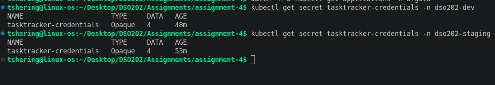


